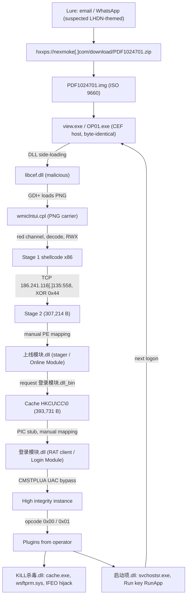
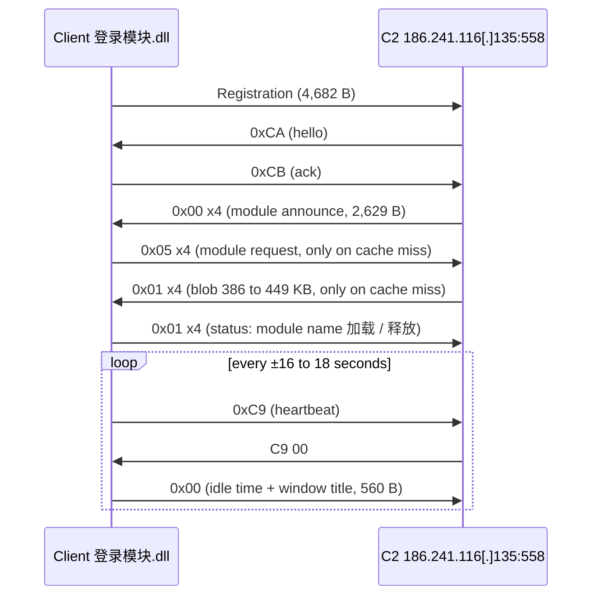

| | |
| --- | --- |
| **Report date** | 6 November 2026 |
| **Analysis period** | 1–6 November 2026 (dynamic runs on 4 November, Windows 10, and 6 November, Windows 11 with Defender enabled) |
| **Primary sample** | `PDF1024701.zip` → `PDF1024701.img` → `view.exe` + `libcef.dll` |
| **Malware family** | ValleyRAT / Winos 4.0 (high confidence, see [§5.1](#51-malware-family-valleyrat--winos-40)) |
| **Actor attribution** | Not established (TTPs consistent with Silver Fox, see [§5.2](#52-actor-silver-fox-and-the-limits-of-attribution)) |
| **Method** | AI-assisted malware analysis (FLARE-VM, REMnux and IDA Pro, with an MCP server connected to an AI model) |
| **Data sources** | Analysis notes `011126`–`061126` in this repository, plus open source references |

**Evidence labels** used throughout this report:

| Label | Meaning |
| --- | --- |
| `CONFIRMED` | Supported by disassembly, bytes, structure, runtime observation, or decoded traffic |
| `STRONG INFERENCE` | Technically strong, not fully proven |
| `INFERENCE` | Plausible, limited evidence |
| `STATIC ONLY` | Present in static analysis but not triggered in either dynamic run. This does **not** mean the capability is absent |

All domains and IPs in this report are *defanged* (`[.]`).

---


## 1. Executive Summary

This sample is a **staged, modular** infection chain that ends in a 32-bit RAT client with full operator control. The chain starts from a ZIP archive containing a disk image, abuses *DLL side-loading* through an executable that looks legitimate, hides shellcode inside a PNG image, then downloads every later stage from the C2 and runs it directly in memory.

Two dynamic runs were performed. In both, the operator pushed two additional plugins live that installed persistence and disabled Windows Defender through two *Bring Your Own Vulnerable Driver* (BYOVD) drivers plus an *Image File Execution Options* (IFEO) hijack. In the second run, on **Windows 11 with Defender and Tamper Protection enabled**, this was proven effective: `MsMpEng.exe` was killed from the kernel within about half a second of the driver loading, and Defender **stayed disabled after a reboot**, while the malware restarted itself from a Run key.

### 1.1 Key characteristics

> [!IMPORTANT]
> **Highlighted findings**
> 1. **Layered, evasion-heavy delivery:** ZIP → ISO/IMG → DLL side-loading (`view.exe` loads `libcef.dll`) → shellcode in PNG (*red channel* steganography) → Stage 2 downloaded from the C2.
> 2. **Fileless payload side:** Stage 2, the login module, and plugins are loaded through *manual PE mapping* from memory. Procmon shows no `Load Image` events for these modules.
> 3. **Two-component C2 architecture:** the stager `上线模块.dll` (Online Module) fetches and caches the RAT client `登录模块.dll` (Login Module) in the Registry. The first module is not a RAT, the second one is.
> 4. **Elevation through the CMSTPLUA COM elevation moniker** (`{3E5FC7F9-9A51-4367-9063-A120244FBEC7}`). The *medium integrity* process exits and a new instance runs at *High integrity*. A UAC prompt (`consent.exe`) appeared every time.
> 5. **Defense evasion proven effective:** two distinct BYOVD drivers (Safetica `stprocessmonitor.sys` and `wsftprm.sys` / CVE-2023-52271) both loaded despite the Vulnerable Driver Blocklist being enabled; `MsMpEng.exe` was killed from the kernel despite Tamper Protection; an IFEO `Debugger` hijack on three Defender binaries kept Defender from starting after reboot.
> 6. **Persistence confirmed and executed:** Run key `RunApp` → `C:\Users\Public\svchostsr.exe` (a copy of `view.exe`), installed by the `启动项.dll` plugin sent by the operator. After a reboot it re-ran the whole chain, reloaded both drivers, and rebuilt the RAT session using plugins cached in the Registry.
> 7. **Broad operator control:** 20 opcodes (drop file, download-and-execute EXE, screenshot, clear event logs, forced reboot/shutdown, reflective DLL plugin loading or `svchost.exe` injection, C2 config update, extra C2 sessions).
> 8. **Final capability is operator-defined.** Only two plugins were seen. Public literature documents dozens of other ValleyRAT plugins (keylogger, file manager, remote terminal, webcam, and more), see [§5.6](#56-follow-on-capabilities-an-operator-may-deploy).
> 9. **Detection gap:** the IFEO hijack is written through a temporary registry hive (`HKLM\TempIFEO`) and restored with `RegRestoreKey`. Sysmon recorded no `SetValue` on the real IFEO path, although the value was proven present at boot.

### 1.2 Malware family

The structure and behavior of the sample **strongly match** **ValleyRAT (also known as Winos / Winos 4.0)**, a modular backdoor in the Gh0st RAT lineage. Basis for the assessment:

- The module names `上线模块` (*Online Module*) and `登录模块` (*Login Module*) match the two early-stage ValleyRAT plugins documented by Check Point Research.
- Check Point's description of the Online Module (embedded C2 configuration, in-process shellcode execution by default, optional `tracerpt.exe` injection) matches what we found in the stager, including the hardcoded `tracerpt.exe` target.
- The persistence plugin we observed exports the name `Scheduled Task.dll`, in line with the ValleyRAT auxiliary plugins `计划任务` (*Scheduled Task*) and `写注册表启动` (*Write Registry Startup*).
- Abuse of `wsftprm.sys` (CVE-2023-52271) has been reported by Fortinet in a Winos 4.0 campaign against Taiwan (February 2026).

### 1.3 Malaysia targeting

The initial download host `nexmoke[.]com` is recorded in **ScanMalware hunt #312**, which tracks a distribution kit built around fake **LHDN** (Lembaga Hasil Dalam Negeri Malaysia / Inland Revenue Board) notices in Malay. The kit delivers archives containing a pair of a signed executable and a malicious DLL (DLL side-loading), sometimes inside a disk image. Details in [§2.1](#21-campaign-context-and-malaysia-targeting) and [§5.3](#53-related-campaigns-and-malaysia-targeting).

> [!NOTE]
> The link between the sample and the LHDN kit is a **STRONG INFERENCE** at the infrastructure level (host and `/download/` pattern). The lure page actually shown to victims on `nexmoke[.]com` was not verified.

### 1.4 Risk assessment

| Aspect | Assessment |
| --- | --- |
| Capability level | Medium-high for an advanced-stage loader and RAT |
| Impact on victim host | **High**: arbitrary code execution, proven endpoint protection tampering that survives reboot, persistence, full system profiling |
| Data impact | Depends on the plugins the operator sends. No credential theft or keylogging was observed in the sample |
| Operator visibility | The operator receives the active window title on every heartbeat, including titles of analysis tools |
| Operator OPSEC weaknesses | Single-byte XOR (`0x44`), constant `0x00CA` in the session header, static mutex, English debug strings, hardcoded C2 IP, no TLS, a leftover builder path string in plugin announcements |
| Recommended action | Treat an infected host as fully *compromised* (rebuild), see [§6](#6-recommendations) |

---

## 2. Timeline

### 2.1 Campaign context and Malaysia targeting

The table below combines public context with our own findings. All entries come from the references in [Appendix B](#appendix-b-references), except those marked *(this sample)*.

| Date | Event | Relevance |
| --- | --- | --- |
| Early 2023 | First public report on ValleyRAT (per Check Point) | Origin of the family |
| June 2024 | Trend Micro documents Winos 4.0 in attacks on Chinese-speaking users, attributed to the *Void Arachne* cluster | Naming and actor overlap |
| 25–26 March 2025 | ValleyRAT builder / C2 panel leaks on GitHub (builder compile timestamp 2025-03-26) | Attribution becomes unreliable because anyone can use the builder |
| May–Sep 2025 | Check Point reports Silver Fox using BYOVD with the WatchDog `amsdk.sys` driver to kill AV/EDR before ValleyRAT | Same BYOVD pattern as our sample |
| October 2025 | Silver Fox expands Winos 4.0 / HoldingHands RAT from China and Taiwan to **Japan and Malaysia** | Malaysia enters the operational scope |
| December 2025 | Check Point publishes a full ValleyRAT dissection (19 main plugins, rootkit driver) | Reference for module structure |
| February 2026 | Sekoia (reported secondhand): Silver Fox's third wave uses a Python stealer with a **Malay-language** phishing site. Fortinet: Winos 4.0 campaign in Taiwan uses `wsftprm.sys` | Malaysia is the primary target in this wave. Same driver as our sample |
| 10 June 2026 | Malay Mail reports fake LHDN emails titled "Notis Tuntutan Cukai & Penalti (Akta 53)" with a 72-hour deadline and a download button pointing to a lookalike site | LHDN-themed lures are active in Malaysia |
| 29 September 2026 | The Star reports Malaysians receiving malware files via WhatsApp (ZIP) | Distribution vector context, not proven related to this sample |
| 22 October 2026 | Compile timestamp of the stager PE `上线模块.dll` *(this sample, not trustworthy)* | Estimated build time |
| **26 October 2026** | `nexmoke[.]com` scanned and recorded in ScanMalware hunt #312 (rule match). The Stage 1 config contains build date `2026.10.26`. URL `hxxps://nexmoke[.]com/download/PDF1024701.zip` observed by VirusTotal Relations with HTTP 200 *(this sample)* | Host-active date, config build date, and sighting coincide |
| 4 November 2026 | Latest sightings of hunt #312 (bridgecitylawncare, wutongshudijieying, and dozens of `daga*[.]com` hosts) | Domain rotation continues |

**Notes on ScanMalware hunt #312** (read directly from the hunt page):

- The kit carries the family tag `lhdn-tax-notice-autodownload-kit-2026-10`, added on 26 October 2026.
- Fake LHDN notices are spread by **email and WhatsApp**. The Malay-language lure page (button `MUAT TURUN DOKUMEN LENGKAP`) points to archives named like tax documents (`CP14_Notice_…zip`, `MyInvois e-Invoice …zip`, `image_….zip`, `TAX….zip`).
- One page variant is a blank page that clicks a hidden download link to a relative `./download/` path. This matches the `/download/PDF1024701.zip` path in our sample.
- The archives pair a signed Windows program with a DLL it loads from the same folder, **sometimes inside a disk image**. This is identical to the `ZIP → IMG → view.exe + libcef.dll` chain in our sample.
- Domains are rotated daily, often expired names bought back and switched to the kit on the day of use.
- One loader on the same kit fetches the *Overlord* remote-access agent from a "TankRat" panel. This means the operator infrastructure serves more than one payload, and **the hunt does not explicitly mention ValleyRAT**. The family assignment in this report comes from our own sample analysis.

> [!NOTE]
> The X post `FatzQatz/status/2114574569470365909` (also referenced by the hunt page) could not be read automatically because the site blocks automated access, and the two other references cited by the hunt (Amirul Cyber and NetbyteSEC articles) were not accessible either. None of the three is used as evidence in this report.

### 2.2 Execution timeline of dynamic run 1: Windows 10 (4 November 2026)

All times are VM local time (UTC+7). Procmon time = PCAP (UTC) time + 7 hours, validated from several event pairs (for example `view.exe` PID 6952 started at 22:34:31.79 and the first SYN to the C2 was at 22:34:31.93). Defender was already disabled in this VM before execution.

| Time | Event |
| --- | --- |
| 22:34:25 | `MpCmdRun.exe` reads a Defender policy that **already existed before execution** (`DisableAntiSpyware=1`) |
| 22:34:31.79 | `Explorer.EXE` → `view.exe` **PID 6952** (medium integrity) |
| 22:34:31.85 | PID 6952 loads `libcef.dll` (DLL side-loading), then `GdiPlus.dll` to decode the PNG `wmiclntui.cpl` |
| 22:34:31.93 | **Stream 49739**: Stage 1 connects to `186.241.116[.]135:558`, sends `39 39 00`, receives Stage 2 (307,214 B) |
| 22:34:33.26 | **Stream 49740** (stager): hello `04 00`, server sends a 101 B module identifier, client requests `登录模块.dll_bin` (opcode `0x05`), server sends the 393,731 B module (opcode `0x01`) |
| 22:34:34.83 | PID 6952 writes the cache `HKCU\CC\0\R32f351a4aeea5e608853d1a56661059` (REG_BINARY 393,731 B) |
| 22:34:34.92 | `consent.exe` invoked by the AppInfo service |
| 22:34:35.18 | `DllHost.exe /Processid:{3E5FC7F9-9A51-4367-9063-A120244FBEC7}` (CMSTPLUA) |
| 22:34:35.58–.62 | DllHost → `view.exe` **PID 1712** (*High integrity*). PID 6952 exits with status 0 |
| 22:34:40.21 | **Stream 49742** (stager owned by 1712): cache matches, **no `0x05` request**, module loaded from the Registry |
| 22:34:40.31 | PID 1712 writes `%TEMP%\EmbeddedDriverService.sys` (35,400 B, Safetica driver) |
| 22:34:40.88 | Kernel service `EmbeddedDriverService` created (Start=3) |
| 22:34:41.92 | PcaSvc reacts to the driver installation and copies the driver to `C:\Windows\Temp\UDD4AD5.tmp` (side artifact) |
| 22:34:56.64 | **Stream 49743**: RAT client `登录模块.dll` connects, sends a 4,682 B registration struct, handshake `0xCA` / `0xCB` |
| 22:34:57.07–.38 | Operator announces and sends 4 module blobs (2 plugins × 2 variants): `KILL杀毒.dll`, `启动项.dll` |
| 22:34:57.28 | KILL plugin loaded. `C:\Users\Public\cache.exe` (357,888 B) written and executed (PID 3672) |
| 22:34:57.31 | `cache.exe` writes `C:\Windows\System32\drivers\kvckiller.sys` (38,816 B) |
| 22:34:57.32–.37 | `cache.exe` performs an IFEO hijack through the *hive snapshot* technique against three Defender binaries |
| 22:34:57.38 | Service `wsftprm` created, then deleted ±270 ms later (22:34:57.65). `cache.exe` exits with status 1 |
| 22:34:57.66 | PID 1712 deletes `cache.exe`. Client status: `KILL杀毒.dll 释放` |
| 22:34:57.67–.72 | Plugin `启动项.dll` copies the loader into `C:\Users\Public\` (`view.exe` → **`svchostsr.exe`**, `libcef.dll`, `wmiclntui.cpl`, `PDF1024701.img`) and *timestomps* (1601) |
| 22:34:57.718 | **`HKCU\...\Run\RunApp = C:\Users\Public\svchostsr.exe`** created |
| 22:35:14–22:38:12 | 11× heartbeat (±17.7 s interval), each followed by an idle time and active window title report |
| 22:38:26 | PID 1712 exits with status 1 (consistent with termination through Task Manager, which the analyst opened at 22:38:06) |

### 2.3 Execution timeline of dynamic run 2: Windows 11 with Defender enabled (6 November 2026)

Host: Windows 11 Pro 25H2 (build 26200), Defender real-time protection **on**, Tamper Protection **on**, VBS/HVCI off, `VulnerableDriverBlocklistEnable = 1`. The sample ran from an ISO mounted as `E:\`. Sysmon and Procmon use the VM clock; the PCAP clock was aligned to it (VM ≈ host + 23.5 s before reboot, + 24.2 s after). Times are VM local time (UTC+7).

| Time | Event |
| --- | --- |
| 01:19:28–01:19:51 | Two executions of `E:\view.exe` (PIDs 10588, 11088) ended with exit status `0xC0000906` (STATUS_VIRUS_INFECTED) after 3–5 seconds, with no network connection. MsMpEng repeatedly scanned `libcef.dll` |
| 01:20:18–01:20:33 | **Analyst manually chose *Allow on device*** to let the sample run (the malware did not bypass Defender's detection of `libcef.dll`). MsMpEng wrote `ThreatIDDefaultAction\2147814523 = 6` and `\2147814524 = 6` |
| 01:20:48 | Third execution, `view.exe` **PID 1508** (medium) |
| 01:20:53–01:20:54 | Stage 1 (port 57362) and stager (port 57364, cache miss, 393,732 B module delivered). Cache written to `HKCU\CC\0\R32f351…` |
| 01:20:55–01:20:58 | `consent.exe`, then DllHost CMSTPLUA (PID 11228, High) → `view.exe` **PID 2192 (High)**. PID 1508 exits with status 0 |
| 01:21:00 | Stager of 2192 (port 57367): cache hit. `EmbeddedDriverService.sys` written, service created |
| **01:21:01.186** | **Sysmon EID 6: Safetica driver loaded** (signer "Microsoft Windows Hardware Compatibility Publisher") |
| **01:21:01.736** | **`MsMpEng.exe` (PID 3200) exits with status 0, 551 ms after the driver load** |
| 01:21:16 | RAT session (port 57371). Operator sends the same 4 plugin blobs. `cache.exe` (PID 8128) written and run |
| 01:21:16.765–.823 | IFEO hijack through hive snapshot: `HKLM\TempIFEO\{MsMpEng.exe, SecurityHealthSystray.exe, SecurityHealthService.exe}\Debugger = systray.exe`, hive files deleted |
| **01:21:16.836** | **Sysmon EID 6: `kvckiller.sys` loaded** (signer "TPZ SOLUCOES DIGITAIS LTDA") |
| 01:21:16.870 | **`SecurityHealthSystray.exe` (PID 4372) exits with status 0, 34 ms later** |
| 01:21:16.977–.991 | Service `wsftprm` deleted. `cache.exe` exits with status 1 and is deleted |
| 01:21:17.067 | **`HKCU\...\Run\RunApp = C:\Users\Public\svchostsr.exe`** created (`libcef.dll` and `wmiclntui.cpl` copied alongside) |
| 01:21:32–01:30 | 30× heartbeat (±16.1 s), each followed by idle time and window title |
| 01:30:51–01:32:14 | Reboot by the analyst |
| **01:32:25 / 01:32:52** | **Boot log: `services.exe` reads `IFEO\MsMpEng.exe\Debugger = systray.exe` while starting WinDefend. No `MsMpEng.exe` process is created** (both attempts) |
| 01:33:33 | `systray.exe "C:\Windows\System32\SecurityHealthSystray.exe"`: the Windows Security tray icon is redirected by the IFEO hijack |
| **01:34:30.59** | **Explorer starts `C:\Users\Public\svchostsr.exe` (PID 8960)** from the Run key |
| 01:34:31–01:34:35 | Stage 1 and stager, CMSTPLUA again after `consent.exe` (DllHost 5868 → `svchostsr.exe` **PID 880, High**). `EmbeddedDriverService.sys` rewritten and **loaded again (01:34:35.343)** |
| 01:34:51 | RAT session (port 50432). Plugins announced and loaded from the Registry cache, **no `0x05` request**. `cache.exe` (PID 9044) run again, **`kvckiller.sys` loaded again (01:34:51.560)** |
| 01:40:07–01:41:49 | PID 880 still running and communicating with the C2 until the end of capture. No `MsMpEng.exe` event appears in Sysmon from 01:21:01 to the end |

Procmon was not capturing between 01:33:30 and 01:40:07; that interval is covered by Sysmon and the PCAP.

### 2.4 Analysis work timeline

| Date | Focus |
| --- | --- |
| 1 Nov | Stage 1, config extraction, Stage 2 acquisition and decode, initial inspection |
| 2 Nov | Stage 2: loader, embedded DLL, configuration, C2 transport |
| 3 Nov | Stage 2 audit: Registry cache, injection, corrections, prioritization |
| 4 Nov | Dynamic analysis in FLARE-VM, cache extraction, initial IDA analysis of `登录模块.dll` |
| 5 Nov | Capability assessment of `登录模块.dll` (IDA), Procmon CSV and PCAP analysis, carving all payloads from the PCAP |
| 6 Nov | Dynamic analysis on Windows 11 with Defender enabled (Sysmon, Procmon, boot log, PCAP), consolidation and final report |

---

## 3. Static Analysis

### 3.1 Full infection flow



The role of each file was reconstructed through static inspection and then confirmed dynamically: `view.exe` loads `libcef.dll` (Procmon, Sysmon), the Registry cache is created and read, and the entire network flow through to plugin delivery was decoded from the PCAP in two independent runs.

### 3.2 Archive contents and reputation

| File | Notes |
| --- | --- |
| `PDF1024701.img` | ISO 9660 |
| `view.exe`, `OP01.exe` | Loader in the form of a CEF application host. Byte-identical (SHA-256 `78fc25ed…0736`) |
| `libcef.dll` | Malicious DLL (SHA-256 `2c68a6e7cf46f791164e9b708af47faf2654ba6569522309ee037c39d24cdc22`). Detected by Defender on Windows 11 |
| `wmiclntui.cpl` | PNG carrier, not a Control Panel applet (hash prefix `5b77c50b…91e6bca7`) |
| Unidentified files | prefixes `62a1b3b9…` and `9950ee49…` |

| File | VirusTotal detections |
| --- | --- |
| `libcef.dll` | 37/72 |
| `PDF1024701.img` | 21/62 |
| `wmiclntui.cpl` | 0/61 |
| `OP01.exe` | 0/72 |

VirusTotal detections are reputation evidence, not behavioral evidence. Note that `wmiclntui.cpl` (carrier) and `OP01.exe` (loader) evade nearly all engines, so detection rests almost entirely on `libcef.dll` and the disk image. This matches the Windows 11 run, where Defender blocked `libcef.dll` but not `view.exe`.

### 3.3 Stage 0: Loader (`view.exe`, `libcef.dll`, PNG carrier)

| Item | Detail | Status |
| --- | --- | --- |
| `view.exe` | PE32 x86, entry RVA `0x22081`, imports `libcef.dll`. Acts as a CEF host, the malicious behavior lives in the companion DLL | CONFIRMED |
| `libcef.dll` | Loads `wmiclntui.cpl` through GDI+, reads bytes from the image **red channel**, decodes them, allocates **RWX** memory, then executes | CONFIRMED |
| `wmiclntui.cpl` | Actually a PNG file. The extracted result is treated as a raw x86 blob with offset 0 as the entry point | CONFIRMED |
| Red-channel decode algorithm | Not reversed. The loader behavior is established by its inputs and outputs (PNG in, working Stage 1 out), not by the decode routine itself | Not analyzed |

Technique highlights: payload hidden inside an image, misleading extension (`.cpl`), and Stage 1 never exists on disk as an executable.

### 3.4 Stage 1: x86 shellcode

**API resolution (the same mechanism is also used by the Stage 2 loader and the cache stub):**
- Access the PEB through `fs:[0x30]`, walk `PEB.Ldr.InMemoryOrderModuleList`, hash the module name, then the export name. Resolver: `sub_70B`.
- Module hash: `h = h * 0x83 + uppercase(wchar)`, mask `0x7FFFFFFF`. Export hash: `131*h + c`. `0x1CCA9CE6` = `KERNEL32.DLL`.

| Hash | API | Hash | API |
| --- | --- | --- | --- |
| `0x1AB9B854` | GetProcAddress | `0x41539501` | getaddrinfo |
| `0x7F201F78` | LoadLibraryA | `0x785E7DD7` | freeaddrinfo |
| `0x5E893462` | VirtualAlloc | `0x313A84C8` | htons |
| `0x06488073` | VirtualFree | `0x092B50DA` | connect |
| `0x705CF2A5` | lstrcmpiA | `0x0F8387DC` | send |
| `0x0DB579CB` | RtlZeroMemory | `0x0F6134B2` | recv |
| `0x1518E9C0` | RtlMoveMemory | `0x14AC161B` | closesocket |
| `0x33522634` | WSAStartup | `0x4FF42CCF` | WSACleanup |
| `0x26402D9F` | socket | | |

**Configuration** (marker `codemark` at file offset `0x7BB`). The configuration text is stored as **reversed UTF-16LE**. After reversing:

```text
|p1:186.241.116.135|o1:558|t1:1|p2:186.241.116.135|o2:558|t2:1|p3:127.0.0.1|o3:80|t3:1|dd:1|cl:1|fz:默认|bb:1.0|bz:2026.10.26|jp:0|bh:0|ll:0|dl:0|sh:0|kl:0|bd:0|
```

Stage 1 only uses `p1/o1/t1` and `p2/o2/t2` (both the same endpoint). The meaning of the other keys is covered in [§3.5](#35-stage-2-stager-上线模块dll-online-module).

**Communication and Stage 2 execution:**
- TCP to `186.241.116[.]135:558` via `getaddrinfo`. Handshake: bytes `39 39 00` (ASCII `99\0`).
- The TCP handler (`sub_33A`) is called twice (channels 1 and 2) to the same endpoint. The UDP handler (`sub_4A3`) exists but is not selected by the sample configuration.
- `recv` accumulates exactly `0x4B00E` (307,214) bytes: 14 bytes of prefix + 307,200 bytes of data. The loop ends when the total is **equal to** the target (not `>=`).
- The Stage 2 buffer is `0x8000E` (RWX), the pointer is advanced by 14 bytes, then XOR `0x44` is applied over `0x4B00E` bytes (the 14-byte prefix is not XORed). The XOR reaches 14 bytes past the data, still inside the zero-filled allocation, so the tail becomes `0x44`. This is not an allocation overflow.
- Stage 2 is called through the pointer at `[ebx+58h]` with argument `[ebx+60h]`, which appears to be the configuration passed to the stager's `load` export ([§3.5](#35-stage-2-stager-上线模块dll-online-module)).
- Stage 1 performs no process creation, persistence, Registry changes, or file operations.

### 3.5 Stage 2: Stager `上线模块.dll` (Online Module)

**Acquisition and layout.** Stage 2 (307,214 B, starting with `jmp 0x497`) is a flat x86 binary containing a loader and one embedded PE32 DLL.

| Region | Content |
| --- | --- |
| `0x0` | `jmp 0x497` |
| stub (`sub_5`, `sub_B0`, `sub_CD`, `sub_1CB`, `sub_497`) | Loader / manual mapper |
| `0x54A` | Loader descriptor |
| `0x5BF` | Embedded PE32 DLL (only this `MZ` candidate validated) |
| `0x1C9BF`–`0x4B00E` | Padding, near-zero entropy |

**Loader (`sub_1CB`)** performs *manual PE mapping*: MZ/PE validation, machine `0x14C`, magic `0x10B`; allocation of `SizeOfImage`; header and section copy; HIGHLOW relocations; import resolution; TLS callbacks; call `DllMain(1)`. The descriptor names the export **`load`**. The extra decoder byte in the descriptor is 0, so no compression or encryption is active.

**Embedded DLL:**

| Property | Value |
| --- | --- |
| Export name | `上线模块.dll` ("go-online module") |
| Architecture | PE32 i386 DLL, ImageBase `0x10000000`, SizeOfImage `0x22000` |
| Timestamp | 2026-10-22 04:13:15 UTC (not trustworthy) |
| Exports | `CCTG` (RVA `0x6BD0`), `load` (`0x6C10`), `run` (`0x6C80`). All three are launchers for the main thread `sub_62CF` |

**Runtime configuration** (`0x12A0`-byte block at VA `0x1001D758`, parsed by `sub_58DF` from the reversed text; 22 keys):

| Key | Function | Value in Stage 1 config |
| --- | --- | --- |
| `p1`/`o1`/`t1` | Host, port, selector for endpoint 1 (`t==1` → TCP, otherwise UDP) | `186.241.116.135` / 558 / 1 |
| `p2`/`o2`/`t2` | Endpoint 2 | same |
| `p3`/`o3`/`t3` | Endpoint 3, used every 200th iteration | `127.0.0.1` / 80 / 1 (placeholder) |
| `cl` | Retry delay (seconds) | `1` |
| `fz` / `bb` / `bz` | Group / version / build date | `默认` / `1.0` / `2026.10.26` |
| `kl` | Payload execution mode: `0` = direct call, `!=0` = `tracerpt.exe` injection | `0` |
| `jp` `bh` `ll` `dl` `sh` `bd`, `dd` | Boolean flags / strings (see [§3.6.9](#369-configuration-flags-and-feature-mapping)) | `0` / `1` |

In addition, the stager reads `HKCU\CC\IpDate` if present (size > 10 bytes) and parses only the nine endpoint keys as an override. In both dynamic runs this value did not exist (NAME NOT FOUND), so the override was never exercised.

**Initialization.** The stager's DllMain only starts the thread if `lstrlenW(config) > 30`. The 15-character static template (`AFAFSAFAVAGAFAF`) makes this condition false, so the DLL is **dormant in its default state**. The `load(config)` path bypasses that check, and this is the path used by Stage 1 (STRONG INFERENCE, consistent with the working C2 session).

**C2 communication:**
- Endpoints 1 and 2 are used alternately, the 200th iteration uses endpoint 3. `Sleep(cl×1000)`, connect, send hello `04 00`, then pump and wait.
- TCP: `socket(2,1,6)`, `gethostbyname`, `connect`; `SO_SNDBUF`/`SO_RCVBUF` 256 KB, `SO_RCVTIMEO` 30,000 ms, `SO_KEEPALIVE`. Heartbeat byte `0xC9`.
- UDP: a `0x270`-byte event-driven object with RTTI `CArqSessionT<CUdpSocket>` and KCP-themed log strings. This indicates an ARQ / reliable-UDP layer (STRONG INFERENCE for KCP, implementation not compared against the reference). **STATIC ONLY**, since `t1:1` selects TCP and no UDP to the C2 was seen in either run.

**Framing** (also used by the login module and **validated from the PCAP in both runs**):

```text
[DWORD  length LE, including this length field]
[10-byte session token = {timeGetTime(), 0, 0x00CA}, per connection]
[payload, XOR 0x44]
```

The receiver requires the peer token to equal the local token. There is no compression or other cipher.

**Packet handler (`sub_4E3F`)** has three paths:

| Condition | Behavior |
| --- | --- |
| `buf[0] == 0xC9` | Heartbeat, ignored |
| `len == 101` | **Module identity check**: read the Registry cache and compare the identifier (`wcscmp`). Match → run the payload. No match → send a type `0x05` packet (2,629 B) requesting module `登录模块.dll_bin` |
| Any other length | **Delivery**: `[cmd:1][header:0xA44][payload]`. The payload is allocated with `VirtualAlloc(PAGE_EXECUTE_READWRITE)` and copied into memory |

- **Registry cache:** `HKCU\CC\0`, value `R32f351a4aeea5e608853d1a56661059`, `REG_BINARY`, content `[header 0xA44][payload]` in plaintext. This is *caching*, not persistence.
- The module identifier in the header (`+0x20C`) is the **MD5 of the payload body** (all bytes after the `0xA44` header), verified for all five modules seen ([§4.6](#46-plugins-delivered-by-the-operator)). The cache check is therefore an MD5 comparison of the cached body against the server's version.
- There is no validation of the header size against the packet length in `sub_4E3F` (CONFIRMED). Exploitability was not assessed because upstream validation in the receive path was not fully examined.

**Payload execution (`sub_4C9F`)**: scans the payload for the marker `denglupeizhi`, copies the 4,768-byte configuration block to the marker location (`memmove`, not a dedicated patcher), then: `kl == 0` → call the buffer directly; `kl != 0` → inject into `tracerpt.exe` (`sub_519F`).

**`tracerpt.exe` injection** (`sub_519F`, **STATIC ONLY**): `CreateProcessA` with `CREATE_SUSPENDED` + `SW_HIDE` on `SysWOW64\tracerpt.exe` (fallback `System32`), `VirtualAllocEx` (RWX), `WriteProcessMemory`, `SetThreadContext` (EIP), `ResumeThread`. This is **suspended-process thread execution hijacking**, not process hollowing (the target image is not unmapped). There is no `TerminateProcess` / `CloseHandle` on failure, so a failure can leave `tracerpt.exe` suspended. A watchdog re-injects if the target ends. Not triggered in either run because the sample config has `kl:0`.

**Component assessment:**
- Category: stager and delivery/communication component, **not** a full RAT.
- No persistence, application-level anti-analysis (`cpuid`, `rdtsc`, `int 2d`), self-delete, or file/shell/credential APIs found.
- The absence of these features in the stager does **not** mean the downloaded payload lacks them.

### 3.6 Follow-on payload: `登录模块.dll` (Login Module, RAT client)

This payload was obtained from the Registry cache (`login_module_cache.bin`, 393,731 B) and from the PCAP, with identical hashes.

#### 3.6.1 File structure

| Region | File offset | Size |
| --- | --- | --- |
| Cache header | `0x0`–`0xA43` | `0xA44` |
| PIC loader stub | `0xA44`–`0xF8D` | `0x54A` |
| Loader data block | `0xF8E`–`0x1002` | `0x75` |
| PE32 DLL | `0x1003`–`0x60202` | `0x5F200` (ends exactly at EOF) |

Header validation: payload size `0x5F7BF` at `+0x208`; module identifier (32-character wide string) `fe3bb0c20a7d3dd74e6807ed1fd4859e` at `+0x20C`; size check `0xA44 + 0x5F7BF = 0x60203` = file size. The stub, data block, and PE layout is **the same** as the stager loader (STRONG INFERENCE that both come from the same template/builder). There is no active compression (unpacked size = packed size, decoder id 0).

**Embedded PE32:** PE32 i386 DLL, ImageBase `0x10000000`, EntryPoint RVA `0x1A037` (CRT wrapper, real DllMain is `sub_13BC3`), SizeOfImage `0x66000`, 5 sections (`.text`, `.rdata`, `.data`, `.fptable`, `.reloc`). Single export `run`. Compiler detected as MSVC 2022. The configuration template is marked by the ASCII marker `denglupeizhi` at VA `0x10059520`: empty hosts, port `"6666"` for slots 1 and 2.

#### 3.6.2 Loader and worker

- The PIC stub performs self-location, PEB walk, API hashing (`imul reg,0x83`), then *manual PE mapping* (`VirtualAlloc` RWX, relocations, imports, TLS, entry point). There is no `VirtualProtect`, so the image stays RWX.
- DllMain creates a single worker thread (`sub_13093`) that effectively never returns. The `run` export is an alternative launcher for the same worker.

#### 3.6.3 C2 communication

1. Endpoints alternate between primary and secondary, switching to the third after 200 failed attempts.
2. `socket(AF_INET, SOCK_STREAM, IPPROTO_TCP)`, host via `gethostbyname`. Socket options are the same as the stager.
3. The client sends a **`0x124A`-byte registration struct** (validated in the PCAP: 4,682 B).
4. The client waits for opcode `0xCA` from the server (up to ±10 s) and replies `0xCB`. Without it the connection is closed and retried (default 3 s).
5. Heartbeat byte `0xC9`. ±10 s was estimated statically, **±17.7 s (run 1) and ±16.1 s (run 2) observed**. The connection closes if no data arrives for more than 60,000 ms; this timeout was never reached because the server always answered the heartbeat.
6. Framing is identical to [§3.5](#35-stage-2-stager-上线模块dll-online-module). The network object is selected through `t`: `t==1` → synchronous TCP client, otherwise an event-driven engine (`WSAEventSelect`).

#### 3.6.4 Operator command surface (`sub_D763`)

Opcode = `byte[0]`. Opcodes `0x14`–`0xC8` do nothing. If the DWORD `HKCU\Console\IpDatespecial` is greater than 1, **all packets are ignored** (this value is checked on every heartbeat and did not exist in either run).

| Opcode | Action | Status |
| --- | --- | --- |
| `0x00` | Announce module (`0xA44` struct). If absent from the cache, the client replies with type `0x05` (request module) | **Observed** |
| `0x01` | Receive module blob, store in Registry, load module | **Observed** |
| `0x02` | Disconnect | STATIC ONLY |
| `0x03`, `0xC9` | Idle time + active window title + screenshot | Partially observed (idle time and window title) |
| `0x04` | Screenshot (GDI/GDI+); reply type `3` + data | STATIC ONLY |
| `0x05` | **Drop file** (`CreateFileW` + `WriteFile`), option to run visible / hidden | STATIC ONLY |
| `0x06` | **Download EXE from URL** (WinINet, `MZ` required) then `CreateProcessW` | STATIC ONLY |
| `0x07` | Set `GROUP` / `REMARK` | STATIC ONLY |
| `0x08` | Check process by name | STATIC ONLY |
| `0x09` | Ping (reply `0x14`) | STATIC ONLY |
| `0x0A` | Parameterized screenshot | STATIC ONLY |
| `0x0B` | **Clear event logs** Application / Security / System (`ClearEventLogW`) | STATIC ONLY |
| `0x0C` | Restart host process | STATIC ONLY |
| `0x0D` | `ExitProcess` | STATIC ONLY |
| `0x0E`–`0x10` | Forced shutdown / reboot (`ExitWindowsEx`) | STATIC ONLY |
| `0x11` | Toggle plugin loading mode: `0` = in-process, `1` = `svchost.exe` injection | STATIC ONLY |
| `0x12` | **Update C2 configuration** (write `HKCU\Console\IpDate`, reconnect) | STATIC ONLY |
| `0x13` | Spawn an **additional C2 session** | STATIC ONLY |
| `0xCA` | Server hello, reply `0xCB` | **Observed** |

The server heartbeat reply (`C9 00`) is followed by the client reporting idle time and window title (11× in run 1 and 30× in run 2, 560 B each), consistent with the `0x03`/`0xC9` handler.

With the combination of drop file, download-and-execute, and DLL plugin loading, the operator effectively holds **arbitrary code execution**. In practice the operator used the plugin channel (opcodes `0x00`/`0x01`) rather than opcodes `0x05`/`0x06`.

#### 3.6.5 Elevation (UAC bypass)

The client checks `TokenElevation`. If not elevated, it calls `CoGetObject("Elevation:Administrator!new:{3E5FC7F9-9A51-4367-9063-A120244FBEC7}")` (CMSTPLUA / `ICMLuaUtil`), then `ExitProcess(0)`. This technique is widely documented (see [§5.5](#55-uac-bypass-via-cmstplua)). **Validated dynamically** in both runs ([§4.5](#45-process-tree-and-elevation)). It is not a silent bypass: `consent.exe` appeared before every elevation, so a user must approve a prompt.

#### 3.6.6 Embedded driver (first BYOVD: Safetica)

- A **x64** PE driver blob (`0x8A48` = 35,400 B) is embedded in `.data` and written as-is (no decryption). Identity: PDB `…\Safetica\Endpoint\Compiled\x64\Release\ProcessMonitorDriver.pdb`, device `\Device\STProcessMonitorDriver`. A legitimate driver that is being abused, listed as **Verified** in LOLDrivers as `stprocessmonitor.sys` (ID `0712c54c-69fd-41f2-950a-da678ac51246`). It carries a valid signature ("Microsoft Windows Hardware Compatibility Publisher").
- Flow: `GetTempPathA` → write `.sys` → create service `EmbeddedDriverService` (`Type=1`, `Start=3`, `ImagePath=\??\<temp>`) → `SeLoadDriverPrivilege` → `NtLoadDriver` → delete file.
- **IOCTL `0xB822200C`** in the driver handler: `ZwOpenProcess(0x1FFFFF)` → `ZwTerminateProcess(handle, 0)` for the supplied PID, **with no caller check**. This primitive can kill arbitrary processes from kernel mode, including PPL processes such as `MsMpEng.exe`.
- Usage in the worker: up to 14 attempts to kill `MsMpEng.exe` (success counted 3× with a 100 ms delay because Defender respawns), followed by writing the `HKLM\SOFTWARE\Policies\Microsoft\Windows Defender` policy (`DisableAntiSpyware=1` and five `Real-Time Protection` values).
- **Dynamic result (run 2):** the driver loaded and `MsMpEng.exe` exited with status 0, 551 ms later (matching `ZwTerminateProcess(handle, 0)`), with Tamper Protection enabled. Sysmon also recorded `view.exe` opening a handle to `MsMpEng.exe` with `GrantedAccess 0x1FF7D4`. The causal link through the IOCTL itself is a STRONG INFERENCE, since Procmon does not record `DeviceIoControl` to the driver. The **policy-writing branch was never executed** in either run: no write to `HKLM\SOFTWARE\Policies\Microsoft\Windows Defender` by any malware process.

#### 3.6.7 Process manipulation and resilience

- **Plugin loader (`sub_CD83`):** mode 0 maps the PE in memory and calls export **`Main`**. Mode 1 injects into `svchost.exe` (suspended, `VirtualAllocEx`, `SetThreadContext`). The blob must contain the marker `plugmark` and is rejected if it contains `onlyloadinmyself`. Only mode 0 was observed (plugin code ran without any `Load Image` event and without a `svchost.exe` created by the malware).
- **Watchdog and respawn:** a watchdog injecting into `svchost.exe` (`CreateRemoteThread`), and a `SetUnhandledExceptionFilter` that restarts the host. Disabled by flags in the sample.
- **Single instance:** mutex `Global\MyUniqueApp_SingleInstance` (NULL DACL). An older instance is located by image SHA-256 (BCrypt) and then terminated.
- **Critical process:** `NtSetInformationProcess` class `0x1D` (ProcessBreakOnTermination) on itself. Terminating the process afterwards can trigger a bugcheck. Disabled by flags in the sample.

#### 3.6.8 Anti-analysis and persistence

- **Window blacklist:** an `EnumWindows` thread every 3 seconds disconnects the C2 if a window title contains any of 19 strings (`Wireshark`, `Fiddler`, `Process`, `TCPEye`, `TaskExplorer`, `任务管理器`, `火绒`, and others). **Disabled in the sample** (flag `0`): in both runs, Wireshark, Procmon, PowerShell, and Task Manager windows were visible and reported to the C2 but the session was never dropped (CONFIRMED).
- No application-level anti-debug, anti-VM, or anti-sandbox was found.
- **Persistence of this module itself:** none (no Run key, scheduled task, or startup folder). Persistence is provided by a **plugin** at runtime ([§4.6](#46-plugins-delivered-by-the-operator)).

#### 3.6.9 Configuration flags and feature mapping

The 4,768-byte configuration block is copied by the stager into the `denglupeizhi` marker in the payload before execution (the patch happens in memory, which is why the marker in the cache remains intact). The layout lines up: `p1` sits at marker + `0x1E` in both components, and the login module `.data` flags align with the stager block offsets. With that mapping (STRONG INFERENCE, supported by pinyin abbreviations): `bh` = *critical process* (保护), `ll` = window blacklist, `sh` = watchdog (守护), `dl` ≈ 登录, `cl` ≈ 重连. All are `0` in the sample config, consistent with these features being disabled in both runs.

This also explains why the login module template looks empty (empty hosts, port `6666`) yet the client still connects to `186.241.116[.]135:558`: the configuration is **filled in at runtime** by the stager.

#### 3.6.10 Victim profiling

A single registration packet (4,682 B) sends: local IP, hostname, OS version and architecture, CPU count, disk and RAM, GPU, screen resolution, process integrity (`高` = High) and user name, image path, PID, detected antivirus (WMI `SecurityCenter2`), system language, host ID, and a list of installed messaging applications (WeChat, WhatsApp, QQ, Telegram, DingTalk, and others). Actual contents from the runs are in [§4.4](#44-c2-protocol-validation-from-the-pcap).

**Not found within the scope of login module analysis:** credential theft, keylogging, clipboard, webcam, microphone, autonomous file enumeration/upload. File access is limited to drop file (opcode `0x05`) and download-and-execute (opcode `0x06`).

### 3.7 Scope and limitations of the static analysis

- Hex-Rays fails on key login module functions (`sub_13093`, `sub_4173`, `sub_6563`). Conclusions come from manually annotated disassembly.
- IDA MCP was used read-only. No payload was executed during static analysis.
- The red-channel decode algorithm and the KCP/UDP internals were not reversed, because neither affects the observed behavior (the PNG decode produces a working Stage 1, and no UDP is used).
- The plugins `KILL杀毒.dll` and `启动项.dll` were analyzed through strings, embedded payloads, and dynamic behavior, not full reverse engineering.

---

## 4. Dynamic Analysis

### 4.1 Environment and methodology

| Item | Run 1 (4 Nov) | Run 2 (6 Nov) |
| --- | --- | --- |
| Lab | FLARE-VM (VMware, Windows 10 x64, build 10.0.19045), REMnux | Windows 11 Pro 25H2 VM (build 26200), VMware vmnet8 / NAT |
| Defender | Disabled before execution (policy present) | **Enabled**, Tamper Protection on, VBS/HVCI off, Vulnerable Driver Blocklist on |
| Sample location | Desktop folder (included `PDF1024701.img`) | Mounted ISO `E:\` (`view.exe`, `libcef.dll`, `wmiclntui.cpl`) |
| Telemetry | Procmon (no Network events, `System` excluded), Wireshark | Sysmon, Procmon (with Network events), boot logging, host-side PCAP |
| Data | Procmon CSV (1,497,366 events), PML (1,528,337), PCAP (100,578 packets; VM `192.168.20.150`) | Sysmon (112,638 events), `pre_reboot.PML` (8,533,498), `Bootlog.pml` (2,822,704), `after_reboot.PML` (294,954), host PCAP (563,267 packets; VM `192.168.20.151`) |
| Tools | Procmon, Wireshark, HashMyFiles, Detect It Easy, Python 3.14 (`dpkt`, `procmon-parser`) | Same, plus `tshark` and `Get-WinEvent` |

Payloads extracted from the PCAP were only hashed and analyzed statically. Carving was done *in-memory* straight into an encrypted archive, because the analyst host antivirus quarantines plaintext PEs. No payload was re-executed outside the two runs, and C2 contact was limited to the two runs themselves. Two Procmon captures from run 2 were unusable (`run1_defender-on.pml` corrupt, `host_vmnet8.pcapng` truncated) and were not used.

### 4.2 Dynamic findings summary

1. The chain from Stage 1 to the RAT client is **fully confirmed** in both runs. Hashes of Stage 2 raw, Stage 2 decoded, the cached `登录模块.dll_bin`, and all four plugin blobs are **identical** across the static analysis, run 1, and run 2.
2. C2 framing is validated. The first token field is proven to be `timeGetTime()`.
3. The operator sent **two plugins** through the RAT session in both runs: `KILL杀毒.dll` and `启动项.dll`.
4. **Defender blocked the initial `libcef.dll`** on Windows 11 (exit `0xC0000906`). The sample only ran because the analyst manually chose *Allow on device*; Defender's detection of `libcef.dll` was not evaded by the malware. Everything after that point (BYOVD, termination of `MsMpEng.exe`, IFEO hijack) is what the malware did once permitted to execute.
5. **BYOVD is effective:** both drivers loaded (Sysmon EID 6) despite the Vulnerable Driver Blocklist, and `MsMpEng.exe` was killed with Tamper Protection on.
6. **The IFEO hijack is effective and persists across reboot:** Defender's service could not start after the reboot, and the Windows Security tray process was replaced by `systray.exe`.
7. **Persistence is effective:** the Run key `RunApp` started `svchostsr.exe` at logon, which repeated the elevation, reloaded both drivers, and re-established the RAT session using plugins cached in the Registry.
8. CMSTPLUA elevation is confirmed, including the Medium → High integrity change, and always required a UAC prompt.
9. **Not observed in either run:** `tracerpt.exe` / `svchost.exe` injection, KCP/UDP, screenshots, opcode-driven drop/download of EXEs, event log clearing, shutdown/reboot, Defender policy writes. These remain `STATIC ONLY`.

### 4.3 Network activity

There is no UDP traffic to the C2 and no DNS query for the C2 (hardcoded IP). All DNS queries in the captures are Microsoft domains. The largest flow in run 1 (138 MB to `23.204.80.234:443`, `oneclient.sfx.ms`) is an OneDrive update and is **unrelated** to the malware.

**Run 1 (PIDs mapped by time correlation, because Procmon recorded no Network events):**

| Stream | Local port | PID | Component | Upload | Download |
| --- | --- | --- | --- | --- | --- |
| 26 | 49739 | 6952 | Stage 1 | 3 B | 307,214 B |
| 27 | 49740 | 6952 | Stager `上线模块.dll` | 2,659 B | 393,861 B |
| 28 | 49741 | 1712 | Stage 1 | 3 B | 307,214 B |
| 29 | 49742 | 1712 | Stager (cache hit) | 16 B | 115 B |
| 33 | 49743 | 1712 | RAT client `登录模块.dll` | 23,866 B | 1,682,133 B |

**Run 2 (PIDs mapped directly from Procmon Network events and Sysmon EID 3):**

| Local port | PID | Component | Upload | Download |
| --- | --- | --- | --- | --- |
| 57362 | 1508 | Stage 1 | 3 B | 307,214 B |
| 57364 | 1508 | Stager (cache miss) | 2,659 B | 393,861 B |
| 57366 | 2192 | Stage 1 | 3 B | 307,214 B |
| 57367 | 2192 | Stager (cache hit) | 16 B | 115 B |
| 57371 | 2192 | RAT client | 35,057 B | 1,682,437 B |
| 50428 | 8960 | Stage 1 (after reboot) | 3 B | 307,214 B |
| 50429 | 8960 | Stager (cache hit) | 16 B | 115 B |
| 50430 | 880 | Stage 1 | 3 B | 307,214 B |
| 50431 | 880 | Stager (cache hit) | 16 B | 115 B |
| 50432 | 880 | RAT client (plugins from cache) | 22,129 B | 11,003 B |

The post-reboot RAT session downloaded only 11,003 B because the four plugins were already cached; no module blobs were re-sent. No C2 connection came from PIDs 10588 and 11088, the two executions blocked by Defender.

### 4.4 C2 protocol validation from the PCAP

**Stage 1 → Stage 2.** The client sends `39 39 00`. The server sends 307,214 B: a 14-byte prefix (`0e b0 04 00` + 10 zero bytes, i.e. the same framing header) followed by 307,200 B of XOR `0x44` data. The SHA-256 of raw and decoded are identical to the static notes in every stream of both runs.

**Stager.**

| Direction | Opcode | Payload | Content (after XOR `0x44`) |
| --- | --- | --- | --- |
| C→S | `0x04` | 2 B | `04 00` (hello) |
| S→C | `0x04` | 101 B | UTF-16LE identifier `fe3bb0c20a7d3dd74e6807ed1fd4859e` |
| C→S | `0x05` | 2,629 B | Module request `登录模块.dll_bin` |
| S→C | `0x01` | 393,731 B | Login module (SHA-256 `8947818d…364a2`) |

- The `sub_4E3F` logic is confirmed: the first stager session (empty cache) sends a `0x05` request, every later session (cache present) **sends no request** and loads the module from the Registry. This held three times in run 2.
- Session token `d1 28 03 00 | 00 00 00 00 | ca 00`: `0x000328D1` = 206,033 ms. The registration reports boot at 22:31:06, and 22:31:06 + 206 s ≈ 22:34:32, so the **first token field = `timeGetTime()`**. Tokens of subsequent streams are consistent (+214 and +230 s).

**RAT client.**



**Registration struct contents (UTF-16LE) from both runs:**

| Field | Run 1 (Windows 10) | Run 2 (Windows 11) |
| --- | --- | --- |
| Local IP / hostname | `192.168.20.150` / `DESKTOP-K6ONVTG` | `192.168.20.151` / `DESKTOP-EF3MMVV` |
| OS / build | `Microsoft Windows 10 专业版` / `10.0.19045` | `Microsoft Windows 11 专业版` / `10.0.26200` |
| Disk / RAM | `HDD:1块 59 Gb Free 13 Gb` / `Mem: 5 Gb Free3 Gb` | `HDD:1块 63 Gb Free 40 Gb` / `Mem: 4 Gb Free2 Gb` |
| Group / version / build date | `默认` / `1.0` / `2026.10.26` | same |
| Process / OS architecture | `X86 x64` | same |
| Integrity / user | `高/flare` (**High**) | `高/admin` (**High**) |
| Detected AV | `Windows Defender` | `Windows Defender` (reported even after `MsMpEng.exe` was killed, because it comes from WMI `SecurityCenter2`) |
| Active window title (`+0x06CE`) | Explorer window of the sample folder | `DVD Drive (E:) 2026_10_26 - File Explorer`; after reboot `Process Monitor - Sysinternals…` |
| Host / bot ID | `10b261eef92d2cf5cfc9fe8038674c23` | `9b22365ce391e90927e992a4103bfb85` (identical before and after reboot) |

The *group* field `默认` and the version `1.0` / date `2026.10.26` are identical to the `fz` / `bb` / `bz` keys in the Stage 1 config. This confirms the configuration flows from Stage 1 to the login module. The host ID differs per machine and is stable across reboots, so it is host-derived; the derivation method was not determined.

**The operator sees the analyst.** The window titles sent after each heartbeat included `Capturing from Ethernet0` (Wireshark), `Task Manager`, `Process Monitor - …\run1_defender-on.pml`, `Process Monitor - Exporting event data`, `Administrator: Windows PowerShell`, and `Save To File`. Since the window blacklist is disabled, the session is not dropped, but the operator can see which analysis tools are in use.

### 4.5 Process tree and elevation

| Run | PID | Process | Integrity | Notes |
| --- | --- | --- | --- | --- |
| 1 | 6952 | `view.exe` | Medium | Launched from `Explorer.EXE`, writes the Registry cache, exits with status 0 |
| 1 | 7128 | `DllHost.exe /Processid:{3E5FC7F9-…}` | High | CMSTPLUA COM server (SysWOW64) |
| 1 | 1712 | `view.exe` | High | Child of DllHost, runs the RAT client and plugins |
| 1 | 3672 | `cache.exe` | High | Dropped by the KILL plugin |
| 2 | 1508 → 11228 → 2192 | `view.exe` → DllHost → `view.exe` | Medium → High | Same pattern before reboot |
| 2 | 8960 → 5868 → 880 | `svchostsr.exe` → DllHost → `svchostsr.exe` | Medium → High | Same pattern after reboot, started from the Run key |
| 2 | 8128, 9044 | `cache.exe` | High | Dropped by the KILL plugin before and after reboot |

`consent.exe` appeared before **every** DllHost CMSTPLUA instance (22:34:34.92 in run 1; 01:20:55 and 01:34:32 in run 2). Elevation therefore requires the user to approve a UAC prompt each time; this technique is not a silent bypass under the default Windows 11 UAC configuration. A MuiCache entry shows the component displayed as "Connection Manager" (`cmlua.dll`), so the prompt most likely shows a Microsoft component name rather than the sample name (INFERENCE; the prompt text itself was not captured).

### 4.6 Plugins delivered by the operator

All four blobs (two plugins × `.dll` and `.dll_bin` variants) are stored in plaintext under `HKCU\Console\0\<32 hex>` (REG_BINARY). The value names are not the MD5 of the module name, identifier, header, body, or the name+identifier combination (UTF-8 and UTF-16LE were checked); their derivation was not determined. The `.dll` variant has the PE at offset `0xA44`, the `.dll_bin` variant has the PE at offset `0x1004` (header + PIC stub), with identical PEs in both.

The module identifier at header offset `+0x20C` equals the MD5 of the body (every byte after the `0xA44` header):

| Module | Body size | Identifier = MD5(body) |
| --- | --- | --- |
| `登录模块.dll_bin` | 391,103 | `fe3bb0c20a7d3dd74e6807ed1fd4859e` |
| `KILL杀毒.dll` | 445,440 | `c07205ae8232c18bc41c710239c00fdb` |
| `KILL杀毒.dll_bin` | 446,911 | `b0ac50e8ff67fbea16bc9ad65432176b` |
| `启动项.dll` | 383,488 | `6121ab74fd0d437ac7060f5b9c8ad230` |
| `启动项.dll_bin` | 384,959 | `12b621547b04ab9a78e99de1139872da` |

The announce struct for `启动项.dll` also contains a leftover string right after the identifier: **`sktop\新版本32\新版本32`**. It appears only in that plugin, identically in both sessions, and looks like an uncleared buffer remnant from a path on the operator's machine such as `…\Desktop\新版本32\新版本32\…` ("new version 32") (INFERENCE). It is usable as an additional indicator for this build or panel.

#### 4.6.1 `KILL杀毒.dll`: AV/EDR killer

| Item | Value |
| --- | --- |
| Export name / timestamp | `Project1.dll` / 2026-08-18 19:44:41 UTC |
| x86 PE (445,440 B) SHA-256 | `0a45c00d0942d28044f5c16bf40cbb62abcbb8492053c50ad1dcf4abda0f68d7` |
| Embedded x64 = `cache.exe` (357,888 B) SHA-256 | `46f65f7089e8bf0468a096247243d513f4667a964c239ea00334431122f1a544` |

**`cache.exe` behavior confirmed in both runs:**
1. Extracts `C:\Windows\System32\drivers\kvckiller.sys` (38,816 B), which is a renamed `wsftprm.sys`.
2. **IFEO Debugger hijack using the hive snapshot technique:** `RegSaveKey` IFEO → `%TEMP%\Ifeo.hiv` → `RegLoadKey HKLM\TempIFEO` → set `Debugger = systray.exe` for `MsMpEng.exe`, `SecurityHealthService.exe`, and `SecurityHealthSystray.exe` → `RegUnloadKey` → `RegRestoreKey` (`REG_FORCE_RESTORE`). This writes IFEO without a direct `RegSetValue` on the IFEO key, which evades detection rules that watch only that path (see below). The hive file and its transaction logs are deleted.
3. Creates kernel service `wsftprm` (ImagePath `kvckiller.sys`), loads the driver, and **deletes the service within ±150–270 ms**. The process exits with status 1 (normal for this tool in both runs).

Notable strings in `cache.exe`: `\\.\Warsaw_PM`, `wsftprm`, `SeLoadDriverPrivilege`, `TempIFEO`, `WinDefCtl.exe`, `[*] Adding IFEO block for MsMpEng.exe...`, `[!] IDR_DRIVER resource not found`. The `IDR_DRIVER` resource is not a raw PE and does not open with the Windows Compression API (XPRESS/LZMS/MSZIP); the driver was identified from the file the tool wrote to disk instead.

**Driver identification (CONFIRMED by hash):** the SHA-256 of `kvckiller.sys` = `ff5dbdcf6d7ae5d97b6f3ef412df0b977ba4a844c45b30ca78c0eeb2653d69a8` is listed in LOLDrivers (ID `30e8d598-2c60-49e4-953b-a6f620da1371`, **Verified**, CVE-2023-52271, impact *antivirus killer*) as `wsftprm.sys`. The match was done locally against `drivers.json` downloaded on 5 November 2026. The driver is signed ("TPZ SOLUCOES DIGITAIS LTDA", valid).

**Observed effect (run 2):**

| Action | Result |
| --- | --- |
| `kvckiller.sys` loaded (Sysmon EID 6) | 01:21:16.836 and again 01:34:51.560 after reboot |
| `SecurityHealthSystray.exe` (PID 4372) | Exited with status 0, 34 ms after the load (the causal link to the driver is a STRONG INFERENCE) |
| IFEO `Debugger = systray.exe` | Read by `services.exe` at boot (01:32:25.008 and 01:32:52.620) when starting WinDefend; **no `MsMpEng.exe`, `NisSrv.exe`, or `MpDefenderCoreService.exe` was ever created afterward** |
| Tray icon | `systray.exe "C:\Windows\System32\SecurityHealthSystray.exe"` ran instead of the real tray process |

A single execution of `cache.exe` therefore keeps Defender **off across reboots** without the malware needing to be running at boot. In run 1 the same sequence ran, but the effect could not be observed because Defender was already disabled and Procmon did not record driver loads.

**Why Windows protections did not stop it (run 2):** `VulnerableDriverBlocklistEnable = 1` did not prevent either driver from loading. With HVCI off, the blocklist may not have been fully enforced, or the driver hashes may not have been in the installed blocklist version (INFERENCE; the blocklist version was not checked). Tamper Protection did not prevent the kernel-level termination of `MsMpEng.exe`, nor the IFEO values written through a hive restore.

#### 4.6.2 `启动项.dll`: persistence

| Item | Value |
| --- | --- |
| Export name / timestamp | `Scheduled Task.dll` / 2026-08-16 17:39:42 UTC |
| x86 PE (383,488 B) SHA-256 | `03f0d1bed58a1c88ed963c60e5d72b2ab21203f369b81a636bd7e0e5f652ebb3` |

**Confirmed behavior:**
- Copies `libcef.dll` (10,896,384 B), `wmiclntui.cpl` (3,468 B), and `view.exe` → **`svchostsr.exe`** (260,048 B) into `C:\Users\Public\`. In run 1 it also copied `PDF1024701.img` (11,223,040 B); in run 2 the source was a mounted ISO that contained only three files and the `.img` was not copied. This indicates the plugin copies **the whole folder of `view.exe`** rather than a fixed file list (STRONG INFERENCE).
- In run 2 `libcef.dll` and `wmiclntui.cpl` carry the Hidden + ReadOnly attributes and `svchostsr.exe` ReadOnly.
- Run 1: *timestomps* all files and the `C:\Users\Public` folder to 01/01/1601. Run 2: a set-information operation on the three files **failed with `0xC000000D` (STATUS_INVALID_PARAMETER)** and Sysmon recorded no creation-time change, so timestomping did not take effect on Windows 11 (INFERENCE that the attempt failed).
- Creates the Run key `HKCU\SOFTWARE\Microsoft\Windows\CurrentVersion\Run\RunApp = C:\Users\Public\svchostsr.exe`. Windows noticed the new entry (`sihost.exe` set `StartupTNotiRunApp`).

Despite its export name "Scheduled Task", no scheduled task creation was seen in either run. `svchostsr.exe` is *masquerading* (resembles `svchost.exe`) and carries the entire DLL side-loading package. **It executed at the next logon** (run 2, 01:34:30.59) and repeated the whole infection chain; `libcef.dll` was apparently no longer blocked because the Defender service was already disabled.

### 4.7 Dynamic results compared with static analysis

| Capability (static) | Dynamic status | Notes |
| --- | --- | --- |
| `view.exe` side-loads `libcef.dll` | **CONFIRMED** | Load Image in all successful runs; Defender blocks `libcef.dll` when active and not allowed |
| `libcef.dll` decodes PNG via GDI+ | CONFIRMED (partial) | `GdiPlus.dll` loaded immediately; the decode routine itself was not reversed |
| Stage 1 TCP, handshake `99\0`, Stage 2 307,214 B | **CONFIRMED** | Identical hashes in every stream of both runs |
| Framing `[len][token][XOR 0x44]` | **CONFIRMED** | Including `timeGetTime()` |
| Cache `HKCU\CC\0\R32f35…` and cache hit | **CONFIRMED** | Cache hit without `0x05` request in 4 sessions |
| C2 override via `IpDate` | Checked, **absent** | The path read by the stager is `HKCU\CC\IpDate` (correction); never written in either run |
| CMSTPLUA elevation | **CONFIRMED** | Medium → High, `consent.exe` every time |
| Safetica driver written, service created, driver loaded | **CONFIRMED** | Hash identical to the embedded blob; Sysmon EID 6 (2×) |
| IOCTL kill of `MsMpEng.exe` | **CONFIRMED (effect)** | `MsMpEng.exe` exit 0, 551 ms after the load; IOCTL link inferred |
| Defender policy write | **NOT SEEN** | Branch never executed in either run |
| Opcodes `0x00` / `0x01` / `0xCA` | **CONFIRMED** | 4 modules received, then loaded from cache after reboot |
| Idle time and window title | **CONFIRMED** | Sent on each heartbeat |
| Window blacklist | Disabled (CONFIRMED) | Analysis tools did not drop the session |
| Plugins run reflectively | CONFIRMED (indirect) | Plugin code runs without `Load Image` |
| Persistence | **DIFFERS from static** | Comes from the `启动项.dll` plugin; executed at logon |
| IFEO Debugger hijack effect | **CONFIRMED** | Effective across reboot |
| Timestomp to 1601 | Confirmed on Windows 10, **not effective on Windows 11** | |
| `tracerpt.exe` / `svchost.exe` injection | STATIC ONLY | No process created |
| UDP / KCP | STATIC ONLY | `t1:1` = TCP |
| Opcodes `0x02`–`0x08`, `0x0A`–`0x13` | STATIC ONLY | Not sent by the operator |

### 4.8 Limitations of the dynamic runs

1. **Run 1 had Defender disabled beforehand** (policy already present, `MsMpEng.exe` not running, the `MsMpEng.exe` IFEO key already existed) and Procmon excluded Network and `System` events, so driver loads and PID ownership were only inferred. Run 2 was designed to close both gaps and did.
2. **Procmon does not record `DeviceIoControl`.** The link between the driver IOCTLs and the termination of `MsMpEng.exe` and `SecurityHealthSystray.exe` rests on exact timing (551 ms and 34 ms) and on the driver code, not on a recorded IOCTL.
3. **The Defender event log was not exported and the run 2 VM was deleted afterwards.** The detection names for the three allowed ThreatIDs (`2147814523`, `2147814524`, and an earlier `2147965211`) are therefore not known, and the blocklist version could not be checked.
4. Procmon was not capturing from 01:33:30 to 01:40:07 in run 2; that interval is covered by Sysmon and the PCAP.
5. Both runs were short (about 4 minutes and about 20 minutes of active C2 session) and the operator only sent two plugins. Many opcodes remain **STATIC ONLY**, and there was no interactive operator activity.
6. The mutex `Global\MyUniqueApp_SingleInstance` could not be verified (Procmon does not record mutex objects).
7. A Windows Update platform run (`MpSigStub.exe`, `MpRecovery.exe`) coincided with the kill of `MsMpEng.exe` in run 2 (01:20:55–01:21:03). The exit status 0, the 551 ms offset from the driver load, and the absence of any `MsMpEng.exe` event for the next 20 minutes point to the driver, but this coincidence is noted for completeness.

---

## 5. Additional Information

### 5.1 Malware family: ValleyRAT / Winos 4.0

**Assessment: ValleyRAT (Winos / Winos 4.0), high confidence.** The earlier analysis notes briefly withdrew Winos as a *lead* because it only rested on similarity of patterns. After comparing with the Check Point Research dissection (December 2025), the correspondence is structural and behavioral, so the assessment was raised.

| Finding in the sample | Public correspondence | Strength |
| --- | --- | --- |
| Module name `上线模块.dll` (Online Module) | Check Point: the *Online Module* is an early-stage plugin with embedded C2 configuration and remote shellcode execution | Strong |
| Stager runs the payload in-process (`kl:0`) or injects into `tracerpt.exe` (`kl!=0`) | Check Point: in-process execution by default, optional `tracerpt.exe` injection | **Very strong** (specific target, not generic) |
| Module name `登录模块.dll` (Login Module) | Check Point: the *Login Module* is the main-stage agent (login / recon, fingerprinting, command processing, reflective plugin loading) | Strong |
| Operator sends additional plugins to the host (`KILL杀毒`, `启动项`) | Check Point: Online and Login modules act as initial beacons that fetch other plugins from the C2, and the operator decides whether a victim deserves further components | Strong |
| Persistence plugin exports `Scheduled Task.dll`, writes a Run key | Check Point: auxiliary plugins `计划任务` (*Scheduled Task*) and `写注册表启动` (*Write Registry Startup*) | Medium (INFERENCE) |
| Registry `HKCU\Console\IpDate`, `IpDatespecial` | Splunk: `HKCU\Software\Console\IpDate` and `IpDateInfo` store C2 config. Check Point: `HKLM\SOFTWARE\IpDates` for shellcode | Medium. Similar names, location varies between versions |
| 1-byte XOR, custom framing, TCP/UDP | Check Point: ValleyRAT plugins use TCP or UDP with custom XOR-based serialization | Medium |
| BYOVD `wsftprm.sys` | Fortinet: used in a Winos 4.0 campaign against Taiwan (February 2026) | Medium |

**Gh0st RAT lineage.** Several reports (including Rapid7 and secondary summaries) say Winos 4.0 is built on Gh0st RAT with a plugin system. The stylistic similarity in our sample (classes `CKernelManager`, `CManager`, `CTcpSocket`, framing with heartbeat and XOR) is consistent with this lineage; no direct code-level comparison against Gh0st was performed.

**Implications of the leaked builder.** Check Point notes that the ValleyRAT builder / C2 panel leaked publicly in March 2025, and about 85% of the samples they detected appeared in the last six months of their observation period. Consequently, the appearance of ValleyRAT does not automatically point to one specific actor.

**Additional correspondence notes.** The export names of our plugins (`Project1.dll`, `Scheduled Task.dll`) differ from the internal file names reported by Check Point (`Driver Plugin.dll`, and so on), but a default export name like `Project1.dll` is common in Visual Studio projects that were not renamed. Our KILL plugin is **not** the `Driver Plugin` (the ValleyRAT `KernelQuick` / `HiddenGate` rootkit), but a `wsftprm.sys`-based *AV killer*.

### 5.2 Actor: Silver Fox and the limits of attribution

Silver Fox (also known as SwimSnake, Valley Thief, UTG-Q-1000, Void Arachne) is a Chinese-speaking cybercrime group active since 2022 and most often associated with ValleyRAT. The TTPs of this campaign are **consistent** with those reported for Silver Fox:

- Locally themed tax / e-invoice lures (Taiwan, India, and now Malaysia).
- DLL side-loading through executables that look legitimate.
- BYOVD to disable AV/EDR, including `wsftprm.sys`.
- Expansion into Malaysia, reported since October 2025.

**However, attribution cannot be established.** Check Point stresses that after the builder leak, ValleyRAT use can no longer be reliably tied to a specific actor. The infrastructure of the LHDN kit in hunt #312 also serves other payloads (Overlord / TankRat). The Chinese-language module names, plugin names, and the `新版本32` builder path remnant indicate a Chinese-speaking developer or operator, but that does not identify a group. This report therefore records **family = ValleyRAT / Winos 4.0 (high confidence)** and **actor = cannot be established; TTPs consistent with Silver Fox (low-to-medium confidence)**.

### 5.3 Related campaigns and Malaysia targeting

| Source | Finding | Relation to the sample |
| --- | --- | --- |
| ScanMalware hunt #312 | Fake LHDN notice kit (email and WhatsApp), archives named like tax documents, DLL side-loading, sometimes inside a disk image, domains rotated daily. `nexmoke[.]com` recorded with a rule match on 26 Oct 2026 | **Direct (sample host)**, STRONG INFERENCE |
| Malay Mail (10 June 2026) | Fake LHDN email "Notis Tuntutan Cukai & Penalti (Akta 53)", 72-hour deadline, green button to a lookalike LHDN site, sender address not `@hasil.gov.my` | Same lure theme, not proven to be the same campaign |
| The Hacker News (Oct 2025) | Silver Fox expands Winos 4.0 / HoldingHands RAT to Japan and Malaysia. Malaysia-focused phishing uses fake landing pages and excise audit themed documents | Precedent for Malaysia targeting by related operations |
| Sekoia (via vpncentral, Feb 2026) | Silver Fox third wave uses a Python stealer with a Malay-language phishing site targeting Malaysia, with waves in Taiwan, Japan, Malaysia, India, Indonesia, Singapore, Thailand, Philippines | Regional context (note: Indonesia is also in the target list of that report) |
| The Star (29 Sep 2026) | Malaysians report receiving malware files via WhatsApp (ZIP) | Vector context, not proven related |

A correlative observation from our own data: the build date in the Stage 1 config (`bz:2026.10.26`), the sighting date of `nexmoke[.]com` in the hunt, and the date VirusTotal Relations observed the URL all coincide on **26 October 2026** (INFERENCE). This suggests the sample was built and distributed on the same day.

> [!NOTE]
> The evidence for Malaysia targeting in our sample is **indirect** (infrastructure and lure pattern). From our own technical analysis, no artifact explicitly points to Malaysia (for example locale checks or Malay strings). The locale handling only extends to reporting the system language in the registration struct.

### 5.4 Abused BYOVD drivers

| Driver | In the sample | Public information |
| --- | --- | --- |
| `stprocessmonitor.sys` (Safetica ProcessMonitor) | Embedded in the login module, loaded as service `EmbeddedDriverService`. IOCTL `0xB822200C` calls `ZwTerminateProcess` without a caller check. **Loaded and killed `MsMpEng.exe` in run 2** | LOLDrivers **Verified**, category vulnerable driver, process-terminate primitive |
| `wsftprm.sys` (Topaz Antifraud) | Dropped by `cache.exe` as `kvckiller.sys` (service `wsftprm`, device `\\.\Warsaw_PM`). **Loaded in run 2** | CVE-2023-52271 (CVSS 6.5): a low-privileged attacker can kill **Protected Process Light** processes through an IOCTL. LOLDrivers **Verified**. Reported in a Winos 4.0 campaign (Fortinet) and many public *EDR killer* tools |

Check Point also documented a similar pattern (the WatchDog driver `amsdk.sys`, built on the Zemana Anti-Malware SDK, Microsoft-signed and at one point absent from the Microsoft blocklist) in a 2025 Silver Fox campaign. Together with run 2, where both drivers loaded despite the Vulnerable Driver Blocklist being enabled, this reinforces the picture that legitimately signed vulnerable drivers are a consistent and effective pattern in the ValleyRAT ecosystem.

### 5.5 UAC bypass via CMSTPLUA

CLSID `{3E5FC7F9-9A51-4367-9063-A120244FBEC7}` is the CMSTPLUA COM class that exposes the `ICMLuaUtil` interface (IID `{6EDD6D74-C007-4E75-B76A-E5740995E24C}`) and supports auto-elevation. The technique has been documented since 2017 (hfiref0x proof of concept) and has ready-made detections: Elastic and Sigma rules monitor `dllhost.exe` with the argument `/Processid:{3E5FC7F9-…}` (or `{D2E7041B-2927-42FB-8E9F-7CE93B6DC937}`) spawning a child process. This exact pattern is visible in the sample in both runs (PID 7128 → 1712; PID 11228 → 2192; PID 5868 → 880). ATT&CK mapping: T1548.002.

### 5.6 Follow-on capabilities an operator may deploy

In our runs, the operator only sent two plugins. Check Point catalogs 19 main ValleyRAT plugins (in 32-bit and 64-bit variants). The list below is **potential** based on public literature, **not** capability observed in this sample:

| Plugin (CN / EN) | Function |
| --- | --- |
| 文件管理 / File Management | Full remote file management |
| 远程终端 / Remote Terminal | Interactive shell (`cmd.exe`) |
| 键盘记录 / Keylogger | Keylogger with clipboard harvesting |
| 系统管理 / System Management | Recon, process/service control, code injection |
| 查注册表 / Check Registry | Remote regedit |
| 视频查看 / Video View | Webcam capture and streaming |
| 语音监听 / 播放监听 | Microphone and audio output capture |
| 高速屏幕, 后台屏幕, 差异屏幕, 娱乐屏幕 | Remote desktop (including a hidden mode with browser automation) and screen streaming |
| 代理映射 / Proxy Mapping | Multiplexed reverse proxy (TCP/UDP tunneling) |
| 压力测试 / Stress Test | DDoS module (TCP/UDP/HTTP/ICMP floods) |
| 驱动插件 / Driver Plugin | Rootkit driver (hide files/registry, process protection, APC injection, force-delete AV/EDR drivers) |

Auxiliary plugins (not verified by Check Point) include browser and messaging app credential stealers (Chrome, QQ, Telegram, WeChat), an internal network scanner, and various persistence and privilege escalation modules. Because the operator decides which plugins to send, the real impact on a victim depends on operator decisions, and **an infected host should be treated as if all of the above capabilities were available**.

### 5.7 MITRE ATT&CK mapping

Status is split by evidence: **Confirmed** (static and/or dynamic confirmation on the sample), **Static only** (present in code but not triggered).

| Tactic | Technique | Basis in the sample | Status |
| --- | --- | --- | --- |
| Initial Access / Execution | T1566 Phishing (LHDN lure, via kit infrastructure) | Link to hunt #312 | Inference |
| Defense Evasion | T1574.002 DLL Side-Loading | `view.exe` loads `libcef.dll` | Confirmed |
| Defense Evasion | T1027.003 Steganography | Payload in PNG red channel | Confirmed (partial) |
| Defense Evasion | T1027 Obfuscated Files or Information | XOR `0x44`, reversed config, API hashing | Confirmed |
| Defense Evasion | T1620 Reflective Code Loading | Manual PE mapping of Stage 2, login module, plugins | Confirmed (indirect) |
| Privilege Escalation | T1548.002 Bypass UAC | CMSTPLUA COM elevation moniker (UAC prompt required) | Confirmed |
| Defense Evasion | T1562.001 Impair Defenses: Disable or Modify Tools | `MsMpEng.exe` killed through BYOVD, IFEO Debugger | **Confirmed effective** |
| Privilege Escalation / Defense Evasion | T1068 Exploitation for Privilege Escalation (vulnerable driver) | `stprocessmonitor.sys`, `wsftprm.sys` loaded | **Confirmed (driver loaded)** |
| Privilege Escalation / Persistence | T1546.012 IFEO Injection | `Debugger=systray.exe` on 3 Defender binaries | **Confirmed effective across reboot** |
| Persistence | T1547.001 Registry Run Keys | `RunApp` → `svchostsr.exe`, executed at logon | **Confirmed executed** |
| Defense Evasion | T1036.005 Masquerading | `svchostsr.exe` | Confirmed |
| Defense Evasion | T1564.001 Hidden Files | Hidden attribute on `libcef.dll`, `wmiclntui.cpl` | Confirmed |
| Defense Evasion | T1070.006 Timestomp | Timestamp 1601 | Confirmed on Windows 10, not effective on Windows 11 |
| Defense Evasion | T1070.004 File Deletion | `cache.exe`, `Ifeo.hiv*`, service `wsftprm` | Confirmed |
| Persistence / Priv Esc | T1543.003 Windows Service | `EmbeddedDriverService`, `wsftprm` | Confirmed |
| Defense Evasion | T1112 Modify Registry | Cache, plugins, config | Confirmed |
| Discovery | T1082 / T1033 / T1518.001 / T1010 | Registration, AV, idle time, window titles | Confirmed |
| Command and Control | T1095 / T1571 / T1008 | Custom TCP, port 558, three-endpoint failover | Confirmed |
| Command and Control | T1105 Ingress Tool Transfer | Stage 2, modules, plugins | Confirmed (Stage 2 and plugins); opcodes `0x05` / `0x06` static only |
| Defense Evasion | T1055.003 Thread Execution Hijacking | `tracerpt.exe`, `svchost.exe` | Static only |
| Defense Evasion | T1070.001 Clear Windows Event Logs | Opcode `0x0B` | Static only |
| Collection | T1113 Screen Capture | Opcode `0x04` / `0x0A` | Static only |
| Impact | T1529 System Shutdown/Reboot | Opcode `0x0E`–`0x10` | Static only |

T1059 (Command and Scripting Interpreter) is **not** supported by evidence in the analyzed modules (no shell or interpreter). T1055.012 (Process Hollowing) is also not supported.

---

## 6. Recommendations

### 6.1 Incident response on an affected host

> [!WARNING]
> Treat the host as **fully compromised**. There are three reasons: (1) kernel-level drivers were proven to load, (2) Defender was proven to be disabled in a way that survives reboot, so visibility cannot be trusted, (3) the operator can send any plugin. A rebuild is safer than cleanup.

1. **Isolate the host from the network** immediately. Block egress to `186.241.116[.]135` (TCP/558) and `nexmoke[.]com`, and add monitoring for the hunt #312 kit domains.
2. **Acquire evidence before cleaning.** Take a memory image first (payloads run from memory), then export the Registry values `HKCU\CC\0\*` and `HKCU\Console\0\*` (plugins are stored in plaintext and can be analyzed directly).
3. **Check and record persistence:** Run key `RunApp`, files in `C:\Users\Public\` (`svchostsr.exe`, `libcef.dll`, `wmiclntui.cpl`, and possibly `PDF1024701.img`), including their Hidden/ReadOnly attributes.
4. **Check for tampering with endpoint protection:**
   - `Debugger` values in IFEO for `MsMpEng.exe`, `SecurityHealthService.exe`, and `SecurityHealthSystray.exe`. If present, Defender will not start until they are removed; a missing Windows Security tray icon or a `systray.exe` child of Explorer is a visible symptom.
   - Policy `HKLM\SOFTWARE\Policies\Microsoft\Windows Defender` (and the `Real-Time Protection` subkey).
   - Services `EmbeddedDriverService` and `wsftprm`, and the file `kvckiller.sys`.
5. **Reset credentials** of accounts that logged in on the host (including browser sessions and messaging apps), since data theft capability depends on plugins and cannot be ruled out.
6. **Rebuild the host** from a clean image. Drivers were proven to load and the endpoint protection was blinded, so a reboot or removal of the visible artifacts cannot be considered sufficient verification of cleanliness.
7. **Check for lateral movement and other exposure:** look for other hosts contacting the network IOCs or showing the same registry artifacts.

### 6.2 Detection engineering

| Log source | Detection logic | Notes |
| --- | --- | --- |
| Sysmon EID 1 / Security 4688 | `dllhost.exe` with argument `/Processid:{3E5FC7F9-9A51-4367-9063-A120244FBEC7}` as the parent of a non-standard process | Public Elastic and Sigma rules for ICMLuaUtil already exist |
| Sysmon EID 1 | `view.exe` or an executable loading `libcef.dll` from an unusual location (mounted ISO/IMG folder, `C:\Users\Public\`) | Tune to avoid catching legitimate CEF applications |
| Sysmon EID 1 | `systray.exe` with the argument `C:\Windows\System32\SecurityHealthSystray.exe` | Indicates the IFEO redirection is active |
| Sysmon EID 11 | File created in `C:\Users\Public\` named `cache.exe`, `svchostsr.exe`, or `libcef.dll` | Executables there with Hidden + ReadOnly attributes are also anomalous |
| Sysmon EID 2 | File creation time changed to the year 1601 | Timestomp indicator (did not trigger on Windows 11) |
| Sysmon EID 6, System 7045 | Driver load / service creation for `EmbeddedDriverService` (ImagePath in `\Users\*\AppData\Local\Temp\`), `wsftprm`, or `kvckiller.sys`. Match driver hashes against LOLDrivers; signer markers: "Microsoft Windows Hardware Compatibility Publisher" (Safetica driver from `%TEMP%`) and "TPZ SOLUCOES DIGITAIS LTDA" (`kvckiller.sys`) | Hashes in Appendix A |
| Sysmon EID 12 / 13 / 14 | Registry: `Run\RunApp`; `RegLoadKey` of `HKLM\TempIFEO` or any hive loaded from `%TEMP%\Ifeo.hiv`; large (> 300 KB) `REG_BINARY` values in `HKCU\CC\0` and `HKCU\Console\0` | See the detection gap below |
| Sysmon EID 23 | Deletion of `Ifeo.hiv`, `.LOG1`, `.TM.blf`, `.regtrans-ms` in `%TEMP%` | |
| Service / health monitoring | `MsMpEng.exe` terminating without a restart, or the WinDefend service failing to start at boot, with `IFEO\MsMpEng.exe\Debugger` set | Direct symptom of the proven effect |
| Sysmon EID 3 / firewall / proxy | Outbound connections to `186.241.116[.]135:558` | |
| Network IDS | TCP flows with the pattern: client sends `39 39 00` at connection start, a 14-byte header with token `.. .. .. .. 00 00 00 00 ca 00`, hello `04 00` | The single-byte XOR lets sensors decode the payload |
| Memory / EDR | RWX allocation from a process that loads a non-standard DLL; `WriteProcessMemory` → `SetThreadContext` → `ResumeThread` on `tracerpt.exe` or `svchost.exe` | Avoid false positives based only on the name `tracerpt.exe` |

> [!WARNING]
> **Detection gap.** Rules that watch only `SetValue` on `HKLM\SOFTWARE\Microsoft\Windows NT\CurrentVersion\Image File Execution Options\…` **will miss this technique**. In run 2 Sysmon recorded the `Debugger` writes only under `HKLM\TempIFEO`, while the real IFEO value was proven present at boot. Detect the `RegLoadKey` / `RegRestoreKey` pattern and the resulting Defender behavior instead, or audit the IFEO values periodically.

### 6.3 Prevention and hardening

**Endpoint:**
- Enable the **Microsoft Vulnerable Driver Blocklist** together with **Memory Integrity (HVCI)**, and add explicit block rules (WDAC) by hash for `wsftprm.sys` and `stprocessmonitor.sys`. In run 2 both drivers loaded with the blocklist option set to `1` but HVCI off, so the blocklist alone is not sufficient.
- Enable Defender **Tamper Protection** and monitor policy changes, but do not rely on it: in run 2 it did not prevent the kernel-level kill of `MsMpEng.exe` or the IFEO values written through a hive restore. Enable relevant ASR rules (block execution from unusual locations).
- Apply **application control** (WDAC / AppLocker) restricting execution from `C:\Users\Public\`, `%TEMP%`, and download folders.
- Restrict ISO/IMG mounting for regular users (or ensure Mark-of-the-Web is propagated), because this chain uses a disk image to bypass MOTW.
- Use **standard accounts** for daily work and set UAC to a stricter level. Elevation required a UAC prompt every time, so non-admin accounts are a real obstacle to the CMSTPLUA technique, and users should be trained to refuse unexpected prompts.

**Email, messaging, and network:**
- Filter email and messages for ZIP/IMG/ISO archives named like tax documents (`CP14_Notice`, `MyInvois`, `TAX`) and links to new domains or recently re-bought expired domains (the pattern noted by hunt #312).
- Apply DNS filtering and young-domain reputation, and block egress to non-standard ports from workstations (TCP/558 in this case).
- User education: official LHDN communication only comes from addresses ending in `@hasil.gov.my` and official channels, and users should not open archives from tax notices demanding fast action (72-hour deadline). Verify through the Hasil Care Line or the official `hasil.gov.my` site.

### 6.4 Threat hunting and intelligence sharing

1. Use the hunt #312 SMQL query on ScanMalware (or its Atom feed) to monitor new kit domains, and add `nexmoke[.]com` and the C2 IP to internal feeds.
2. Run a retrospective search over 30–90 days of logs: connections to `186.241.116[.]135:558`, creation of services `EmbeddedDriverService` / `wsftprm`, Run key `RunApp`, IFEO `Debugger` values on Defender binaries, and `dllhost.exe` with the CMSTPLUA CLSID.
3. Share the IOCs in Appendix A with the community and internal feeds. Given the Malaysia targeting, consider coordination with Malaysia's CERT (MyCERT / NACSA) through official channels.
4. Track developments in ValleyRAT and Silver Fox, since leaked infrastructure and builders make new variants appear quickly. The leftover string `sktop\新版本32\新版本32` and the identifier-as-MD5 scheme are usable pivots for finding related builds.

---

## Appendix A: Corrections to Earlier Notes

This report uses the latest version whenever a newer note corrects an older one. Summary of corrections that affect conclusions:

| Earlier claim | Correction | Correction source |
| --- | --- | --- |
| No persistence in this chain | Persistence exists, delivered by the plugin `启动项.dll` (Run key `RunApp`), and executes at logon | Dynamic (runs 1 and 2) |
| Family attribution: UNKNOWN (Winos only a withdrawn lead) | ValleyRAT / Winos 4.0, high confidence | Comparison with Check Point (this report) |
| Login module template empty (port `6666`) | Config is filled in at runtime by the stager, client connects to `:558` | Dynamic |
| Heartbeat ±10 seconds | ±17.7 s (run 1), ±16.1 s (run 2) | Dynamic |
| `IpDate` read at `HKCU\CC\0\IpDate` | `HKCU\CC\IpDate` | Procmon |
| Plugins stored in `HKCU\Console\IpDate` | `HKCU\Console\0\<32 hex>` | Dynamic |
| Handshake `99 39 00` | `39 39 00` | Static |
| Stage 2 injection = process hollowing (T1055.012) | Thread-context hijacking (no image unmapping) | Static |
| Registry cache = persistence | Payload cache only | Static |
| `System32` fallback = 64-bit target | Not necessarily (WOW64 redirection) | Static |
| Absence of file/shell/credential APIs in the stager applies to the payload too | Login module has drop file, download-and-execute, screenshot, defense evasion (still no credential theft or keylogging) | Static |
| Defender probably disabled by the login module / BYOVD effect not tested | Defender is disabled by the **KILL plugin chain and the Safetica driver**; the effect was proven in run 2. The login module's Defender **policy-writing** code never executed in either run | Dynamic (run 2) |
| Registration field `+0x06CE` = working directory | It is the **active window title** | Dynamic (run 2) |
| Module identifier `fe3bb0c2…` of unknown meaning | MD5 of the module body | Dynamic (run 2) |
| Elevation might be silent / needs analyst confirmation | A UAC prompt appears every time | Dynamic (run 2) |
| Timestomp to 1601 as a general behavior | Worked on Windows 10, did not take effect on Windows 11 | Dynamic (run 2) |
| `PDF1024701.img` copied for an unknown reason | Plugin copies the whole folder of `view.exe`; the `.img` was absent in run 2 because the source ISO did not contain it | Dynamic (run 2) |

---

## Appendix B: References

**Internal analysis**
- Analysis notes `011126_part1` through `061126` (repo `fj4rr/malware-analysis`, folder *Phising Malware Targetting Malaysia*).

**Malaysia targeting and related campaigns**
- ScanMalware, hunt #312, "Fake Malaysian tax-authority (LHDN) notices that hand out DLL side-loading archives": <https://scanmalware.com/hunts/312>
- X post referenced by the hunt (could not be accessed automatically, not used as evidence): <https://x.com/FatzQatz/status/2114574569470365909>
- Malay Mail, 10 June 2026, fake LHDN email with a 72-hour deadline: <https://www.malaymail.com/amp/news/malaysia/2026/06/10/received-an-lhdn-email-demanding-action-in-72-hours-heres-how-to-spot-if-its-a-scam/223213>
- Malay Mail, 10 June 2026, guidance for suspicious tax demands: <https://www.malaymail.com/news/malaysia/2026/06/10/lhdn-scam-alerts-what-to-do-if-you-receive-suspicious-tax-demands/223226>
- The Star, 29 September 2026, malware file via WhatsApp: <https://www.thestar.com.my/tech/tech-news/2026/09/29/malaysians-report-being-targeted-by-malware-file-sent-through-whatsapp>
- The Hacker News, October 2025, Silver Fox / Winos 4.0 in Japan and Malaysia: <https://thehackernews.com/2025/10/silver-fox-expands-winos-40-attacks-to.html>
- Sekoia (read through a vpncentral summary): <https://vpncentral.com/?p=247471>

**ValleyRAT / Winos 4.0 and Silver Fox**
- Check Point Research, "Cracking ValleyRAT: From Builder Secrets to Kernel Rootkits" (10 Dec 2025): <https://research.checkpoint.com/2025/cracking-valleyrat-from-builder-secrets-to-kernel-rootkits/>
- Check Point Research, "Chasing the Silver Fox: Cat & Mouse in Kernel Shadows" (2025): <https://research.checkpoint.com/2025/silver-fox-apt-vulnerable-drivers/>
- Fortinet FortiGuard Labs, "Massive Winos 4.0 Campaigns Target Taiwan" (20 Feb 2026), read through secondary summaries: <https://www.fortinet.com/blog/threat-research/massive-winos-40-campaigns-target-taiwan>
- Rapid7, "NSIS Abuse and sRDI Shellcode: Anatomy of the Winos 4.0 Campaign" (22 May 2025): <https://www.rapid7.com/blog/post/2025/05/22/nsis-abuse-and-srdi-shellcode-anatomy-of-the-winos-4-0-campaign>
- Splunk Threat Research, "ValleyRAT Insights: Tactics, Techniques, and Detection Methods": <https://www.splunk.com/en_us/blog/security/valleyrat-insights-tactics-techniques-and-detection-methods>

**Vulnerable drivers and UAC bypass**
- NVD, CVE-2023-52271 (Topaz Antifraud `wsftprm.sys`): <https://nvd.nist.gov/vuln/detail/CVE-2023-52271>
- LOLDrivers (entries for `wsftprm.sys` and `stprocessmonitor.sys`): <https://www.loldrivers.io/>
- Elastic, "UAC Bypass via ICMLuaUtil Elevated COM Interface": <https://www.elastic.co/guide/en/security/current/uac-bypass-via-icmluautil-elevated-com-interface.html>
- hfiref0x, UAC bypass via CMSTPLUA (proof of concept): <https://gist.github.com/hfiref0x/196af729106b780db1c73428b5a5d68d>

---

## Appendix C: Indicators of Compromise

> [!NOTE]
> This appendix reproduces `IOCs.md` from the same repository folder. All domains and IPs are defanged.

### Network

| Indicator | Notes |
| --- | --- |
| `186.241.116[.]135:558/TCP` | C2 for Stage 1 / Stage 2 / RAT (hardcoded, no DNS) |
| `hxxps://nexmoke[.]com/download/PDF1024701.zip` | Initial download URL (VirusTotal Relations, 2026-10-26, HTTP 200). Host recorded in ScanMalware hunt #312 |
| `127.0.0.1:80` | `p3` placeholder in config (not a real IOC) |
| `6666` | Default port in the login module template (overridden at runtime) |
| Handshake `39 39 00` | Start of the Stage 1 connection (client → server) |
| Hello `04 00`, heartbeat `0xC9` / `C9 00`, ack `0xCA` / `0xCB` | Protocol patterns |
| Header token `?? ?? ?? ?? 00 00 00 00 ca 00` (offset +4), payload XOR `0x44` | Framing pattern |

**Hunt #312 kit domains (context, not all proven related to the sample):** `hasilgov-my[.]shop`, `hasil-gov-my[.]shop`, `hasilgov-my[.]my[.]id`, `mhftee[.]my[.]id`, `wwcvda[.]my[.]id`, `mida[.]cam`, `midaoity[.]my`, `satgob-mx[.]shop`, `dagavb[.]com`, `welovetheherbs[.]com`, `homescapestaging[.]com`, `goezbar[.]com`, `cartesproduction[.]com`, `bridgecitylawncare[.]com`. Operator server IPs listed in the hunt: `101.32.164[.]111`, `103.97.131[.]121`, `43.128.218[.]147`, `43.134.121[.]203`.

### Files and hashes

| Object | Size | SHA-256 | MD5 |
| --- | --- | --- | --- |
| `view.exe` = `OP01.exe` = `svchostsr.exe` | | `78fc25ed9a673f26eadf03dd5472dc112155138410cd5c81f8b89ccef5bf0736` | `c663ac03855f3e7ff9fde06bd6e24aec` |
| `libcef.dll` | 10,896,384 | `2c68a6e7cf46f791164e9b708af47faf2654ba6569522309ee037c39d24cdc22` | `de1923be3a91ac12cd416ef5b6eeb717` |
| Stage 2 raw | 307,214 | `8a1ef3f3b9606deea8bfa50419acd2ea583a42298ed301a5d7533c855e95e65c` | |
| Stage 2 decoded | 307,214 | `89ecf3e82d8ed7834244a6837523bc3fe1eb5cb4ad9cb81ee935628116ab74c5` | |
| `上线模块.dll` (stager) | 115,712 | `607599486156203946451be3c239f72f7090b0f63a214a38c48e504c41f99f05` | `543d8b746d0f38bd42a8c83502cc7f92` |
| `login_module_cache.bin` | 393,731 | `8947818d801513f303b92091e6302a520593944615b1e8b51d77722374d364a2` | `c8bd5c8f16064b3397035d6a71304e46` |
| `登录模块.dll` (embedded PE) | 389,632 | `fe057e29571b291c44ee2f7fc5d7302132f4ace65d361b629858dd00fda7fe2c` | `4bdaa6ac414b156c0983370b88d2956c` |
| Safetica driver `EmbeddedDriverService.sys` | 35,400 | `70bcec00c215fe52779700f74e9bd669ff836f594df92381cbfb7ee0568e7a8b` | `485a04675df7cf40a8865706e003eb25` |
| `kvckiller.sys` (`wsftprm.sys`) | 38,816 | `ff5dbdcf6d7ae5d97b6f3ef412df0b977ba4a844c45b30ca78c0eeb2653d69a8` | `2f4b5a0d98bc4e5616f2dd04337ae674` |
| `cache.exe` (x64, AV killer) | 357,888 | `46f65f7089e8bf0468a096247243d513f4667a964c239ea00334431122f1a544` | `89733460266ebe94928157c96023e27c` |
| Plugin `KILL杀毒.dll` (blob) | 448,068 | `ce1b8e12bd470c5da0475d6a92e5e2769b08aa1d52903b83d8a1d07ba54d82c5` | |
| Plugin `KILL杀毒.dll_bin` (blob) | 449,539 | `a31ca2ab16e6667f8bd99a67929d446b7f739ffe41e65e01d4fbf85b585ee3d1` | |
| `KILL杀毒` PE (`Project1.dll`) | 445,440 | `0a45c00d0942d28044f5c16bf40cbb62abcbb8492053c50ad1dcf4abda0f68d7` | `c07205ae8232c18bc41c710239c00fdb` |
| Plugin `启动项.dll` (blob) | 386,116 | `8086dd3c153096c68bf65ae4c4b16a6e234ff17f676924054ca9f2679005da97` | |
| Plugin `启动项.dll_bin` (blob) | 387,587 | `549a0238fe3c1fbc38c51743fe6aa2ac497c91a375d125196dd779b5f4268224` | |
| `启动项` PE (`Scheduled Task.dll`) | 383,488 | `03f0d1bed58a1c88ed963c60e5d72b2ab21203f369b81a636bd7e0e5f652ebb3` | `6121ab74fd0d437ac7060f5b9c8ad230` |

Module identifiers (`+0x20C`, = MD5 of the body): `fe3bb0c20a7d3dd74e6807ed1fd4859e` (`登录模块.dll_bin`), `c07205ae8232c18bc41c710239c00fdb` (`KILL杀毒.dll`), `b0ac50e8ff67fbea16bc9ad65432176b` (`KILL杀毒.dll_bin`), `6121ab74fd0d437ac7060f5b9c8ad230` (`启动项.dll`), `12b621547b04ab9a78e99de1139872da` (`启动项.dll_bin`).

Full hashes of `wmiclntui.cpl`, `PDF1024701.zip`, and `PDF1024701.img` were not recorded (prefixes only, see [§3.2](#32-archive-contents-and-reputation)). The carved samples above are available in the archive `samples_051126_infected.zip` (AES-256, password `infected`).

### Host artifacts

**Registry:**

| Key / value | Description |
| --- | --- |
| `HKCU\CC\0\R32f351a4aeea5e608853d1a56661059` | Cache of `登录模块.dll_bin` (REG_BINARY 393,731 B) |
| `HKCU\CC\IpDate` | Read by the stager (C2 override, absent in both runs) |
| `HKCU\Console\0\aa996919f197f1cf0b69b5800cd6db52`, `…\ebfdc592c71ab782daa2b7dc0b4fefe9` | Plugin `KILL杀毒` (two variants) |
| `HKCU\Console\0\32c639b4cb5bb8a322b559fecb1504d9`, `…\d1d1f1a7b4bf5ba671488dc317d8c954` | Plugin `启动项` (two variants) |
| `HKCU\Console\IpDatespecial` | Gating, checked on every heartbeat (absent in both runs) |
| `HKCU\Console\IpDate` | C2 config (written by opcode `0x12`, STATIC ONLY) |
| `HKCU\SOFTWARE\Microsoft\Windows\CurrentVersion\Run\RunApp` | `C:\Users\Public\svchostsr.exe` |
| `HKLM\SYSTEM\CurrentControlSet\Services\EmbeddedDriverService` | Safetica driver service |
| `HKLM\SYSTEM\CurrentControlSet\Services\wsftprm` | Temporary service (created then deleted) |
| `HKLM\SOFTWARE\Microsoft\Windows NT\CurrentVersion\Image File Execution Options\{MsMpEng.exe, SecurityHealthService.exe, SecurityHealthSystray.exe}\Debugger = systray.exe` | IFEO hijack (persists across reboot) |
| `HKLM\TempIFEO` | Temporary hive (the only place Sysmon sees the `Debugger` write) |
| `HKLM\SOFTWARE\Policies\Microsoft\Windows Defender` (+ `\Real-Time Protection`) | Policy written by the login module (code only, never seen in either run) |

**Files:**
- `%LOCALAPPDATA%\Temp\EmbeddedDriverService.sys` (35,400 B), signer "Microsoft Windows Hardware Compatibility Publisher"
- `C:\Windows\System32\drivers\kvckiller.sys` (38,816 B), signer "TPZ SOLUCOES DIGITAIS LTDA"
- `C:\Users\Public\cache.exe` (deleted after running)
- `C:\Users\Public\svchostsr.exe`, `libcef.dll`, `wmiclntui.cpl`, and possibly `PDF1024701.img` (timestamp 01/01/1601 on Windows 10; Hidden + ReadOnly attributes on `libcef.dll` and `wmiclntui.cpl`)
- `%LOCALAPPDATA%\Temp\Ifeo.hiv*` (temporary)
- `C:\Windows\Temp\UDD4AD5.tmp` (PcaSvc side artifact, not reliable as an IOC)

**Other objects and strings:**
- Mutex `Global\MyUniqueApp_SingleInstance` (STATIC ONLY). Devices `\\.\STProcessMonitorDriver` and `\\.\Warsaw_PM`. IOCTL `0xB822200C`.
- Strings: `codemark`, `denglupeizhi`, `plugmark`, `onlyloadinmyself`, module identifier `fe3bb0c20a7d3dd74e6807ed1fd4859e`, names `上线模块.dll`, `登录模块.dll`, `登录模块.dll_bin`, `KILL杀毒.dll`, `启动项.dll`; announce-struct remnant `sktop\新版本32\新版本32`.
- Process: `DllHost.exe /Processid:{3E5FC7F9-9A51-4367-9063-A120244FBEC7}` as the parent of `view.exe` / `svchostsr.exe`; `cache.exe` from `C:\Users\Public\`; `systray.exe` launched with `SecurityHealthSystray.exe` as its argument.
- Defender ThreatIDs allowed by the analyst in run 2 (detection names not mapped): `2147814523`, `2147814524`; `2147965211` was already present before the run.
